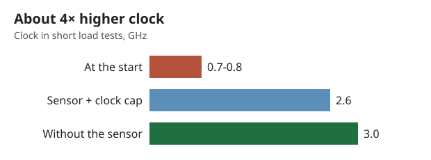

<div id="english" class="post-language" lang="en" markdown="1">

**TLDR:**

- My shelved tablet is usable again.
- About 4× faster under long load: from 0.7-0.8 to 3 GHz.
- No disassembly. GLM found the cause.

## The tablet is back out of the drawer

My ThinkPad X1 Tablet Gen 3 came from US distribution and was being sold off to the rest of the world. The screen coating was so bad that it scratched if you looked at it, so I put 3MK protective glass on it.

Then the throttling: a moment of turbo, then minutes of crawling, at worst 0.7 GHz. Disabling turbo was my best workaround. The tablet went into a drawer. Now I can work on it again.

## Two brakes off, about 4× faster



The first brake was Windows power saving: switching it off and choosing Best performance gave 2.1 GHz. The second was the sensor: without it, 3 GHz. All with eight threads on mains, one run per step. Work in this test follows the clock.

## XTU showed 25 W, the processor fell to 8 W

There are two sets of power limits and the lower one wins. Intel XTU sets one, Intel's thermal driver the other. When a sensor on the board reached 56 °C, the driver cut the power to about 8 W, although the processor itself can take about 100 °C.

Intel specifies 15 W for this chip, configurable up to 25 W. I set 25 W as the ceiling. Without the sensor, cooling stops it at about 17 W.

## GLM found the cause once it had a measurable goal

The AI needed one sentence from me:

> Under sustained load, reach the maximum power the cooling allows, but no more than 25 W.

"Fix the throttling" lets an agent stop at a readback of 25 W. This goal can only be proven under load.

GLM through ZCode found the fix. Claude helped with tracing, review and this post, but I think GLM would have managed on its own once success was defined.

## Working hardware need not be scrapped

A four-core i7, 16 GB of RAM and an NVMe were one step from landfill because of firmware policy. That is an extreme waste of silicon and of everything it took to make it.

Lenovo washed its hands of it. Yet no new hardware was needed, not even a repaste: the potential was behind one threshold. I call that laziness, and the planet pays for it. The greenest computer is the one you don't throw away.

## Limits: cooling, less protection for the case, effects not yet measured

- **Cooling:** about 17 W today, not 25 W.
- **Protection:** the sensor guarded the case, and there is a battery inside. Remove it on mains only and bring it back on battery.
- **Not measured:** the effect on the case and the battery. My automatic switching has not yet passed an unplug test under load.
- **Gentler option:** keep the sensor and cap turbo at 2.6 GHz. One test gave 90% of the work, at 72 °C instead of 96 °C.

**Rebuild it with an AI.** Everything needed is in the four sections below. Give your agent this:

```plaintext
Success: under sustained load, the maximum power the cooling allows,
but no more than 25 W.
My ThinkPad X1 Tablet Gen 3 throttles again. Read the whole post, including
the collapsed sections:
https://blog.ww86.eu/hardware/2026/11/19/x1-tablet-25w-throttling.html
Start read-only: run the check, look for what changed, tell me what you found.
Ask before the load test and before every change, and give me a rollback.
No third-party ring0 drivers, no Defender exclusions, nothing above 25 W.
```

<details markdown="1">
<summary>How it works, and how we know</summary>

XTU writes the MSR limit. Intel Dynamic Tuning (DTT) writes the MMIO limit. When the board sensor `CPUP` reaches 56 °C, DTT drops its limit to 8.5 W. An ETW trace showed who writes it. At the start, with power saving in the way, the CPU settled at 4.4 W and 36-42% of its nominal 2.1 GHz. Work per second was not recorded then. The later steps, seconds 60-120 of each test:

<div class="table-responsive" markdown="1">

| Setup | Power | Clock | Temperature, max | Work/s |
|---|---|---|---|---|
| 25 W, sensor active | 8.4 W | 2.1 GHz | 72 °C | 5410 |
| Turbo capped at 2.6 GHz | 11.4 W | 2.6 GHz | 72 °C | 7059 |
| 25 W, sensor removed | 16.6 W | 3.0 GHz | 96 °C | 7864 |
{: .table}

</div>

A later six-minute run, after a reboot: 16.7 W on average, about 3 GHz, no cut. These measurements predate `TdpModeService`.

- PL1/PL2 are power limits. Setting them to 25 W does not switch the cTDP level and its base clock.
- An XTU readback proves nothing about the MMIO limit. Believe only a load test.

**Find out who writes the limit**

```powershell
# Admin. Start the trace, run the load test in another window, then press on.
$dir = Join-Path $env:TEMP 'x1-trace'; New-Item -ItemType Directory -Force $dir | Out-Null
'DptfCpuEtwProvider', 'DptfAcpiEtwProvider', 'EsifLfEtwProvider', 'EsifUmdf2EtwProvider', 'DPTF', 'Lenovo-Thermal-Service' |
  Set-Content "$dir\providers.txt" -Encoding ASCII
logman start x1dtt -pf "$dir\providers.txt" -o "$dir\dtt.etl" -ets
Start-Sleep -Seconds 130
logman stop x1dtt -ets
tracerpt "$dir\dtt.etl" -o "$dir\dtt.csv" -of CSV -y
```

```powershell
# Decode the trace: 0x59a0 = PL1, 0x59a4 = PL2, raw value / 8 = watts.
$csv = Join-Path $env:TEMP 'x1-trace\dtt.csv'
$prev = ''
Get-Content $csv | ForEach-Object {
  $line = $null
  if ($_ -match 'offset (0x59a[04])\[14:0\] = (0x[0-9a-fA-F]+)') {
    $line = '{0} = {1} W' -f $Matches[1], ([Convert]::ToInt32($Matches[2], 16) / 8)
  } elseif ($_ -match 'CPUP D0: TEMPERATURE = (\d+)') {
    $line = 'CPUP = {0:N1} C' -f ($Matches[1] / 10 - 273.15)
  }
  if ($line -and $line -ne $prev) { $line; $prev = $line }
}
```

A cut looks like `CPUP` reaching about 56 °C, followed by `0x59a0` falling towards 8.5 W. Writes without that trigger mean a different policy or program: search the CSV for `SET_RAPL_POWER_LIMIT` and `Policy`.

**Dead ends, and Linux as plan B**

<div class="table-responsive" markdown="1">

| Tried | Outcome |
|---|---|
| XTU limits alone | MSR only, DTT still cuts |
| Stopping esifsvc and LITSSVC | 8-12 W: the policy runs in the UMDF driver |
| Disabling CPUP in Device Manager | Not supported |
| Removing the processor participant | BIOS limit applies: 8.5-9 W |
| ThrottleStop, WinRing0 | Vulnerable driver blocked by Defender (CVE-2020-14979). The build I tried cannot write this MMIO address anyway |
| Undervolting | Voltage controls are read-only on BIOS 1.51 |
| cTDP or thermal settings in BIOS WMI | None exposed |
{: .table}

</div>

Untested plan B for a home server: on Linux both limits are in `/sys/class/powercap` (`intel-rapl:0` is MSR, `intel-rapl-mmio:0` is MMIO). Don't run `thermald --adaptive`, it applies the same thermal table. Check bit 63 of MSR 0x610: if set, the MSR is locked until reset.

</details>

<details markdown="1">
<summary>Check whether this is your case</summary>

- Order: check, what changed, load test, symptom table, trace if still unclear. Change things last.
- Run one load test at a time and never while another agent is tuning.
- Ask the owner before a change, a reboot or stopping a service.

**Check the state (read-only)**

```powershell
# Read-only, no admin needed.
Add-Type -Namespace X1 -Name Power -MemberDefinition @'
[DllImport("powrprof.dll")] public static extern uint PowerGetEffectiveOverlayScheme(out Guid g);
'@
$g = [Guid]::Empty; [void][X1.Power]::PowerGetEffectiveOverlayScheme([ref]$g)
"CPU:          " + (Get-CimInstance Win32_Processor).Name
"BIOS:         " + (Get-CimInstance Win32_BIOS).SMBIOSBIOSVersion
"last boot:    " + (Get-CimInstance Win32_OperatingSystem).LastBootUpTime
"battery:      " + (Get-CimInstance Win32_Battery).BatteryStatus + " (1 = discharging, 2 = mains)"
"power mode:   $g (for a load test expect ded574b5-45a0-4f42-8737-46345c09c238 = Best performance)"
"CPUP present: " + [bool](Get-PnpDevice -InstanceId 'ACPI\INT3403\CPUP' -ErrorAction SilentlyContinue | Where-Object Present)
Get-Service TdpModeService, XTU3SERVICE, esifsvc, LITSSVC -ErrorAction SilentlyContinue | Format-Table Name, Status
Get-Process mode-watch, ThrottleStop -ErrorAction SilentlyContinue | Format-Table Name, Id
Get-ScheduledTask -TaskName 'TDP*' -ErrorAction SilentlyContinue | Format-Table TaskName, State
Get-CimInstance Win32_PnPSignedDriver | Where-Object DeviceName -match 'Dynamic Tuning' |
  Sort-Object DeviceName -Unique | Format-Table DeviceName, DriverVersion
```

Without admin some tasks are invisible. An empty list is no proof that there are none.

**Load test**

```powershell
# No admin needed. 120 s of full load: the case gets hot. Mains power only.
Add-Type -TypeDefinition @'
using System; using System.Threading;
public static class X1Burn {
  static volatile bool stop; public static long Work;
  public static void Start(int n) {
    stop = false; Work = 0;
    for (int i = 0; i < n; i++) {
      var t = new Thread(() => { double x = 1.0001; while (!stop) {
        for (int k = 0; k < 100000; k++) { x = Math.Sqrt(x * 1.000001 + 0.5); }
        Interlocked.Increment(ref Work); } });
      t.IsBackground = true; t.Start();
    }
  }
  public static void Stop() { stop = true; }
}
'@
"PASS: in every 10 s window after s30 the CPU is at the thermal limit (94 C+) or at 25 W. Never above 25 W on average."
$names = '\Energy Meter(RAPL_Package0_PKG)\Power',
         '\Processor Information(_Total)\% Processor Performance',
         '\Thermal Zone Information(*)\Temperature'
$rows = @(); $sw = [Diagnostics.Stopwatch]::StartNew()
[X1Burn]::Start(8)
try {
  while ($sw.Elapsed.TotalSeconds -lt 120) {
    $v = (Get-Counter $names -SampleInterval 2 -MaxSamples 1).CounterSamples.CookedValue
    $r = [pscustomobject]@{ t = [math]::Round($sw.Elapsed.TotalSeconds); W = [math]::Round($v[0] / 1000, 1)
      GHz = [math]::Round($v[1] * 2.112 / 100, 2); C = [math]::Round($v[2] - 273.15) }
    $rows += $r; "{0,4} s {1,6} W {2,6} GHz {3,4} C" -f $r.t, $r.W, $r.GHz, $r.C
    if ($r.C -ge 101 -or (Get-CimInstance Win32_Battery).BatteryStatus -eq 1) { 'ABORTED'; break }
  }
} finally { [X1Burn]::Stop() }
# verdict
$mean = ($rows | Where-Object t -ge 60 | Measure-Object W -Average).Average
$short = @($rows | Where-Object t -ge 40 | Where-Object {
  $t = $_.t; $win = $rows | Where-Object { $_.t -gt $t - 10 -and $_.t -le $t }
  ($win | Measure-Object W -Average).Average -lt 24 -and ($win | Measure-Object C -Maximum).Maximum -lt 94
})
$ok = $rows[-1].t -ge 118 -and $mean -le 25.5 -and $short.Count -eq 0
"mean={0:N1} W  windows short of both limits={1}  pass={2}" -f $mean, $short.Count, $ok
```

The counter names are localised on some Windows installations. The clock is the performance counter times 2.112 GHz. A fixed number of watts is the wrong criterion, because cooling changes. Short dips at the thermal limit are fine.

**It throttles again: symptom, cause, action**

<div class="table-responsive" markdown="1">

| Symptom | Likely cause | Action |
|---|---|---|
| Turbo, then 8 W at 65-78 °C, CPUP present | The sensor is back: reboot, driver or Windows update, device rescan, resume | Find out what restored it, then, with consent, “Fix it and undo it” |
| 8 W from the first second, CPUP absent | A low MMIO limit was left behind when the sensor was removed | Let it cool, then, with consent, “Fix it and undo it” |
| A slide to 4-6 W at 53-57 °C | Energy saver or Best power efficiency, which override the chosen mode | Energy saver off, Best performance |
| Flat 15 W, below 95 °C | A limit left over from battery use, or XTU limits lost | Check the power source, set 25 W again |
| Flat 8.5-9 W, the DTT processor participant is missing | Without DTT the BIOS MMIO value applies | pnputil /scan-devices |
| Below 15 W at 96 °C, thermal flag set | Dust, dried paste, blocked vents, hot room | Cooling, not software |
| Limits differ from what was set | Another program writes them: XTU profiles, ThrottleStop, UXTU, Vantage, a new DTT | List recent changes, then trace |
| Low power and low CPU usage | No throttling, just no load | Run the load test |
| Switching takes minutes under load | Scheduled tasks default to priority 7, below normal | Task priority 4 or higher (a lower number) |
{: .table}

</div>

Suspect new software? List the recent changes:

```powershell
# Read-only. What was installed or updated in the last 14 days?
$since = (Get-Date).AddDays(-14)
@(
  Get-WinEvent -FilterHashtable @{ LogName = 'System'; StartTime = $since; ProviderName = 'Microsoft-Windows-WindowsUpdateClient'; Id = 19 } -ErrorAction SilentlyContinue
  Get-WinEvent -FilterHashtable @{ LogName = 'System'; StartTime = $since; Id = 7045 } -ErrorAction SilentlyContinue
) | Sort-Object TimeCreated -Descending |
  ForEach-Object { '{0:s} {1}' -f $_.TimeCreated, ($_.Message -replace '\s+', ' ') }
Get-WinEvent -FilterHashtable @{ LogName = 'Application'; StartTime = $since; ProviderName = 'MsiInstaller'; Id = 1033 } -ErrorAction SilentlyContinue |
  ForEach-Object { '{0:s} {1}' -f $_.TimeCreated, ($_.Message -replace '\s+', ' ') }
```

XTU monitor IDs for telling the limits apart: 1000 package power, 2701131777 package temperature, 3 thermal throttling, 22 power limit, 23 EDP, 26 VR.

</details>

<details markdown="1">
<summary>Fix it and undo it</summary>

**Warning: this removes the manufacturer's protection of the case, so do it on mains only and bring the sensor back before using the battery.** To undo it, use “Back to factory” below.

**Restore the 25 W mode**

```powershell
# Admin, on mains, while the tablet is cool and idle. Energy saver must be off.
if ((Get-CimInstance Win32_Battery).BatteryStatus -eq 1) { throw 'On battery: keep the sensor.' }
Add-Type -Namespace X1 -Name Overlay -MemberDefinition @'
[DllImport("powrprof.dll")] public static extern uint PowerSetActiveOverlayScheme(Guid g);
'@
[void][X1.Overlay]::PowerSetActiveOverlayScheme([Guid]'ded574b5-45a0-4f42-8737-46345c09c238')

Start-Service XTU3SERVICE
$dll = 'C:\Program Files\Intel\Intel(R) Extreme Tuning Utility\Client\IntelOverclockingSDK.dll'
$asm = [Reflection.Assembly]::LoadFrom($dll)
$lib = [Activator]::CreateInstance($asm.GetType('Intel.Overclocking.SDK.IntelOverclockingLibrary'))
$lib.Initialize()
$t = $lib.TuningLib
$t.Tune([uint32]48, [decimal]25, $false)   # PL1, W
$t.Tune([uint32]47, [decimal]25, $false)   # PL2, W
$t.Tune([uint32]66, [decimal]28, $false)   # tau, s
$t.ApplyChanges($false)
48, 47, 66 | ForEach-Object { $t.GetControl([uint32]$_).ActiveValue }   # 25, 25, 28

pnputil /scan-devices                               # sensor back, DTT writes its cool-state 29 W
Start-Sleep -Seconds 20
pnputil /remove-device 'ACPI\INT3403\CPUP'          # sensor out, confirm the limit with a load test
```

Run the load test afterwards. If XTU fails to initialise, wait: its service can need 35 s after boot. The safer alternative gave 90% of the work in a two-minute test:

```powershell
# Admin. Safer alternative: cap turbo and keep the sensor. Use 0 to undo.
powercfg /setacvalueindex SCHEME_CURRENT SUB_PROCESSOR PROCFREQMAX 2600
powercfg /setactive SCHEME_CURRENT
```

**Back to factory**

```powershell
# Admin. Stop the automation first, or it removes the sensor again.
if (Get-Service TdpModeService -ErrorAction SilentlyContinue) {
  Set-Service TdpModeService -StartupType Disabled
  Stop-Service TdpModeService -Force
}
Get-ScheduledTask -TaskName 'TDP*' -ErrorAction SilentlyContinue | Disable-ScheduledTask
Get-ScheduledTask -TaskName 'TDP*' -ErrorAction SilentlyContinue | Stop-ScheduledTask
Get-Process mode-watch -ErrorAction SilentlyContinue | Stop-Process
pnputil /scan-devices
Start-Sleep -Seconds 3
[bool](Get-PnpDevice -InstanceId 'ACPI\INT3403\CPUP' -ErrorAction SilentlyContinue | Where-Object Present)   # True
powercfg /setacvalueindex SCHEME_CURRENT SUB_PROCESSOR PROCFREQMAX 0
powercfg /setdcvalueindex SCHEME_CURRENT SUB_PROCESSOR PROCFREQMAX 0
powercfg /setactive SCHEME_CURRENT
Get-Service TdpModeService -ErrorAction SilentlyContinue | Format-Table Name, Status, StartType   # Stopped, Disabled
# Choose "Balanced" in Settings, then reboot: the power limits return to the boot values.
```

**If you automate it**

My tablet runs the service `TdpModeService` from `C:\Program Files\TDP`. It removes the sensor on mains and restores it on battery. Look for it, and for older `TDP-*` tasks, before blaming anything else. It has not been accepted yet. An automation must:

- keep every file that SYSTEM runs, its folder, owner, backups and task writable by administrators only,
- restore the sensor first on battery, before touching XTU, and treat an unknown power source as battery,
- use one lock and check the power source again after every wait and after removing the sensor,
- run at normal or higher priority, otherwise full load delays it for minutes,
- handle unplug, plug-in, resume, Fast Startup and a killed process, ignore battery percentage changes,
- not re-seat the sensor periodically: act only when the state is wrong,
- log the final state and return an error when a step fails,
- watch the power source during every start-up wait, and not leave the sensor out when it stops,
- pass a real test: unplug under full load, plug in, sleep, reboot.

</details>

<details markdown="1">
<summary>Values, versions, identifiers</summary>

<div class="table-responsive" markdown="1">

| Item | Known good state, November 2026 |
|---|---|
| Machine | ThinkPad X1 Tablet Gen 3 (20KK), i7-8650U, BIOS 1.51 (N1ZET95W), Windows 11 build 26300 |
| Software | Intel XTU 7.4.1.3, Intel DTT 8.7.10200.12510 |
| Spec | 15 W at 1.9 GHz, cTDP-up 25 W at 2.1 GHz, cTDP-down 10 W at 0.8 GHz |
| MSR limit (0x610), set with XTU | PL1 = PL2 = 25 W, tau = 28 s |
| MMIO limit (MCHBAR+0x59A0/0x59A4), set by DTT | 29 W when cool, 8.5 W after the cut |
| Limiter | DTT Passive Policy 2, sensor ACPI\INT3403\CPUP, trip 56 °C from the BIOS |
| On mains | CPUP absent, Best performance (set by hand), Energy saver off |
| On battery | CPUP present, clock capped at 2.4 GHz by Windows, XTU stays at 25 W |
| Automation | Service `TdpModeService` in `C:\Program Files\TDP`, not yet accepted |
| Healthy full load | 15-18 W, 2.9-3.1 GHz, 95-98 °C, short dips to 13-14 W |
| The cut | 20 W for 15-50 s, then about 8 W, 2 GHz or less, 65-78 °C |
{: .table}

</div>

**Reported upstream**

- Universal x86 Tuning Utility: [tuning fails silently without its driver](https://github.com/JamesCJ60/Universal-x86-Tuning-Utility/issues/408).
- ThrottleStop: [broken Polish letters in paths and other bugs](https://www.techpowerup.com/forums/threads/ts-9-7-i7-8650u-win11-24h2-ini-mojibake-non-ascii-username-tpl-window-not-uia-accessible-driver-ioctls-winring0.354938/).
- Pengwin, found on the way: [a login script swallows stdin](https://github.com/WhitewaterFoundry/Pengwin/issues/818).

</details>

</div>

<div id="polski" class="post-language" lang="pl" markdown="1">

**TLDR:**

- Tablet z szuflady znów nadaje się do pracy.
- Pod długim obciążeniem około 4× szybszy: z 0,7-0,8 do 3 GHz.
- Bez rozkręcania. Przyczynę znalazł GLM.

## Tablet wrócił z szuflady

Mój ThinkPad X1 Tablet Gen 3 pochodził z dystrybucji z USA i był wyprzedawany na resztę świata. Powłoka ekranu była tak zła, że rysował się od patrzenia, więc założyłem szkło ochronne 3MK.

Do tego dławienie: chwila turbo, potem minuty wleczenia się, w najgorszych momentach 0,7 GHz. Najlepszym obejściem było wyłączenie turbo. Tablet wylądował w szufladzie. Teraz znów da się na nim pracować.

## Dwa hamulce mniej, około 4× szybciej


Pierwszym hamulcem było oszczędzanie energii Windows: bez niego, w trybie najlepszej wydajności, było 2,1 GHz. Drugim czujnik: bez niego 3 GHz. Wszystko na ośmiu wątkach i zasilaczu, po jednym przebiegu na krok. Praca w tym teście idzie za zegarem.

## XTU pokazywało 25 W, procesor spadał do 8 W

Są dwa komplety limitów mocy i wygrywa niższy. Jeden ustawia Intel XTU, drugi sterownik termiczny Intela. Gdy czujnik na płycie dochodził do 56 °C, sterownik ścinał moc do około 8 W, choć sam procesor wytrzymuje około 100 °C.

Intel podaje dla tego układu 15 W z możliwością ustawienia 25 W. Ustawiłem 25 W jako sufit. Bez czujnika chłodzenie zatrzymuje go na około 17 W.

## GLM znalazł przyczynę, gdy dostał mierzalny cel

AI potrzebowało ode mnie jednego zdania:

> Osiągnij pod stałym obciążeniem maksymalną moc, na jaką pozwala chłodzenie, ale nie więcej niż 25 W.

„Napraw dławienie” pozwala agentowi skończyć na odczycie 25 W. Ten cel da się udowodnić tylko pod obciążeniem.

Naprawę znalazł GLM przez ZCode. Claude pomagał w diagnozie, recenzji i przy wpisie, ale moim zdaniem po określeniu sukcesu GLM poradziłby sobie sam.

## Sprawnego sprzętu nie trzeba wyrzucać

Czterordzeniowe i7, 16 GB RAM i NVMe były o krok od wysypiska przez politykę firmware'u. To skrajne marnowanie krzemu i wszystkiego, co zużyto na jego produkcję.

Lenovo się wypięło. A nie trzeba było nowego sprzętu ani nawet wymiany pasty: potencjał był za jednym progiem. Dla mnie to lenistwo, a płaci za nie środowisko. Najbardziej ekologiczny komputer to ten, którego nie wyrzucasz.

## Ograniczenia: chłodzenie, słabsza ochrona obudowy, skutki niezmierzone

- **Chłodzenie:** dziś około 17 W, nie 25 W.
- **Ochrona:** czujnik pilnował obudowy, a w środku jest bateria. Usuwaj go tylko na zasilaczu i przywracaj na baterii.
- **Niezmierzone:** wpływ na obudowę i baterię. Moje automatyczne przełączanie nie przeszło jeszcze testu odpięcia pod obciążeniem.
- **Łagodniejsza droga:** zostaw czujnik i ogranicz turbo do 2,6 GHz. W jednym teście dało to 90% pracy przy 72 °C zamiast 96 °C.

**Odtwórz to z AI.** Wszystko, co potrzebne, jest w czterech sekcjach niżej. Daj agentowi to:

```plaintext
Sukces: pod stałym obciążeniem maksymalna moc, na jaką pozwala chłodzenie,
ale nie więcej niż 25 W.
Mój ThinkPad X1 Tablet Gen 3 znów się dławi. Przeczytaj cały wpis, razem
ze zwiniętymi sekcjami:
https://blog.ww86.eu/hardware/2026/11/19/x1-tablet-25w-throttling.html
Zacznij od odczytu: uruchom sprawdzenie, poszukaj, co się zmieniło, zdaj raport.
Pytaj przed testem obciążeniowym i przed każdą zmianą, podawaj sposób cofnięcia.
Bez obcych sterowników ring0, bez wyjątków w Defenderze, nic powyżej 25 W.
```

<details markdown="1">
<summary>Jak to działa i skąd to wiadomo</summary>

XTU zapisuje limit w MSR, a Intel Dynamic Tuning (DTT) w MMIO. Gdy czujnik płyty `CPUP` dochodzi do 56 °C, DTT obniża swój limit do 8,5 W. Kto go zapisuje, pokazał ślad ETW. Na początku, gdy przeszkadzało oszczędzanie energii, procesor stabilizował się na 4,4 W i 36-42% nominalnych 2,1 GHz. Pracy na sekundę wtedy nie zapisano. Kolejne kroki, sekundy 60-120 każdego testu:

<div class="table-responsive" markdown="1">

| Ustawienie | Moc | Zegar | Temperatura, maks. | Praca/s |
|---|---|---|---|---|
| 25 W, czujnik działa | 8,4 W | 2,1 GHz | 72 °C | 5410 |
| Turbo przycięte do 2,6 GHz | 11,4 W | 2,6 GHz | 72 °C | 7059 |
| 25 W, czujnik usunięty | 16,6 W | 3,0 GHz | 96 °C | 7864 |
{: .table}

</div>

Późniejszy test sześciominutowy, po restarcie: średnio 16,7 W, około 3 GHz, bez cięcia. Te pomiary są starsze niż `TdpModeService`.

- PL1/PL2 to limity mocy. Ustawienie 25 W nie przełącza poziomu cTDP i jego zegara bazowego.
- Odczyt z XTU niczego nie mówi o limicie MMIO. Wierz tylko testowi pod obciążeniem.

**Ustal, kto zapisuje limit**

```powershell
# Admin. Start the trace, run the load test in another window, then press on.
$dir = Join-Path $env:TEMP 'x1-trace'; New-Item -ItemType Directory -Force $dir | Out-Null
'DptfCpuEtwProvider', 'DptfAcpiEtwProvider', 'EsifLfEtwProvider', 'EsifUmdf2EtwProvider', 'DPTF', 'Lenovo-Thermal-Service' |
  Set-Content "$dir\providers.txt" -Encoding ASCII
logman start x1dtt -pf "$dir\providers.txt" -o "$dir\dtt.etl" -ets
Start-Sleep -Seconds 130
logman stop x1dtt -ets
tracerpt "$dir\dtt.etl" -o "$dir\dtt.csv" -of CSV -y
```

```powershell
# Decode the trace: 0x59a0 = PL1, 0x59a4 = PL2, raw value / 8 = watts.
$csv = Join-Path $env:TEMP 'x1-trace\dtt.csv'
$prev = ''
Get-Content $csv | ForEach-Object {
  $line = $null
  if ($_ -match 'offset (0x59a[04])\[14:0\] = (0x[0-9a-fA-F]+)') {
    $line = '{0} = {1} W' -f $Matches[1], ([Convert]::ToInt32($Matches[2], 16) / 8)
  } elseif ($_ -match 'CPUP D0: TEMPERATURE = (\d+)') {
    $line = 'CPUP = {0:N1} C' -f ($Matches[1] / 10 - 273.15)
  }
  if ($line -and $line -ne $prev) { $line; $prev = $line }
}
```

Cięcie to `CPUP` dochodzący do około 56 °C, po którym `0x59a0` spada w stronę 8,5 W. Zapisy bez tego wyzwalacza oznaczają inną politykę lub program: szukaj w CSV `SET_RAPL_POWER_LIMIT` i `Policy`.

**Ślepe uliczki i Linux jako plan B**

<div class="table-responsive" markdown="1">

| Próba | Wynik |
|---|---|
| Same limity XTU | Tylko MSR, DTT dalej ścina |
| Zatrzymanie esifsvc i LITSSVC | 8-12 W: polityka działa w sterowniku UMDF |
| Wyłączenie CPUP w Menedżerze urządzeń | Nieobsługiwane |
| Usunięcie uczestnika procesora | Obowiązuje limit BIOS-u: 8,5-9 W |
| ThrottleStop, WinRing0 | Podatny sterownik blokowany przez Defendera (CVE-2020-14979). Sprawdzona kompilacja i tak nie zapisze tego adresu MMIO |
| Undervolting | Kontrolki napięć tylko do odczytu w BIOS-ie 1.51 |
| Ustawienia cTDP lub termiczne w WMI BIOS-u | Brak |
{: .table}

</div>

Niesprawdzony plan B dla serwera domowego: w Linuksie oba limity są w `/sys/class/powercap` (`intel-rapl:0` to MSR, `intel-rapl-mmio:0` to MMIO). Nie uruchamiaj `thermald --adaptive`, stosuje tę samą tabelę termiczną. Sprawdź bit 63 MSR 0x610: jeśli ustawiony, MSR jest zablokowany do resetu.

</details>

<details markdown="1">
<summary>Sprawdź, czy to Twój przypadek</summary>

- Kolejność: sprawdzenie, co się zmieniło, test, tabela objawów, ślad, jeśli dalej nie wiadomo. Zmiany na końcu.
- Jeden test naraz i nigdy, gdy inny agent zmienia ustawienia.
- Pytaj właściciela przed zmianą, restartem i zatrzymaniem usługi.

**Stan (tylko odczyt)**

```powershell
# Read-only, no admin needed.
Add-Type -Namespace X1 -Name Power -MemberDefinition @'
[DllImport("powrprof.dll")] public static extern uint PowerGetEffectiveOverlayScheme(out Guid g);
'@
$g = [Guid]::Empty; [void][X1.Power]::PowerGetEffectiveOverlayScheme([ref]$g)
"CPU:          " + (Get-CimInstance Win32_Processor).Name
"BIOS:         " + (Get-CimInstance Win32_BIOS).SMBIOSBIOSVersion
"last boot:    " + (Get-CimInstance Win32_OperatingSystem).LastBootUpTime
"battery:      " + (Get-CimInstance Win32_Battery).BatteryStatus + " (1 = discharging, 2 = mains)"
"power mode:   $g (for a load test expect ded574b5-45a0-4f42-8737-46345c09c238 = Best performance)"
"CPUP present: " + [bool](Get-PnpDevice -InstanceId 'ACPI\INT3403\CPUP' -ErrorAction SilentlyContinue | Where-Object Present)
Get-Service TdpModeService, XTU3SERVICE, esifsvc, LITSSVC -ErrorAction SilentlyContinue | Format-Table Name, Status
Get-Process mode-watch, ThrottleStop -ErrorAction SilentlyContinue | Format-Table Name, Id
Get-ScheduledTask -TaskName 'TDP*' -ErrorAction SilentlyContinue | Format-Table TaskName, State
Get-CimInstance Win32_PnPSignedDriver | Where-Object DeviceName -match 'Dynamic Tuning' |
  Sort-Object DeviceName -Unique | Format-Table DeviceName, DriverVersion
```

Bez uprawnień administratora część zadań jest niewidoczna. Pusta lista nie dowodzi, że ich nie ma.

**Test obciążeniowy**

```powershell
# No admin needed. 120 s of full load: the case gets hot. Mains power only.
Add-Type -TypeDefinition @'
using System; using System.Threading;
public static class X1Burn {
  static volatile bool stop; public static long Work;
  public static void Start(int n) {
    stop = false; Work = 0;
    for (int i = 0; i < n; i++) {
      var t = new Thread(() => { double x = 1.0001; while (!stop) {
        for (int k = 0; k < 100000; k++) { x = Math.Sqrt(x * 1.000001 + 0.5); }
        Interlocked.Increment(ref Work); } });
      t.IsBackground = true; t.Start();
    }
  }
  public static void Stop() { stop = true; }
}
'@
"PASS: in every 10 s window after s30 the CPU is at the thermal limit (94 C+) or at 25 W. Never above 25 W on average."
$names = '\Energy Meter(RAPL_Package0_PKG)\Power',
         '\Processor Information(_Total)\% Processor Performance',
         '\Thermal Zone Information(*)\Temperature'
$rows = @(); $sw = [Diagnostics.Stopwatch]::StartNew()
[X1Burn]::Start(8)
try {
  while ($sw.Elapsed.TotalSeconds -lt 120) {
    $v = (Get-Counter $names -SampleInterval 2 -MaxSamples 1).CounterSamples.CookedValue
    $r = [pscustomobject]@{ t = [math]::Round($sw.Elapsed.TotalSeconds); W = [math]::Round($v[0] / 1000, 1)
      GHz = [math]::Round($v[1] * 2.112 / 100, 2); C = [math]::Round($v[2] - 273.15) }
    $rows += $r; "{0,4} s {1,6} W {2,6} GHz {3,4} C" -f $r.t, $r.W, $r.GHz, $r.C
    if ($r.C -ge 101 -or (Get-CimInstance Win32_Battery).BatteryStatus -eq 1) { 'ABORTED'; break }
  }
} finally { [X1Burn]::Stop() }
# verdict
$mean = ($rows | Where-Object t -ge 60 | Measure-Object W -Average).Average
$short = @($rows | Where-Object t -ge 40 | Where-Object {
  $t = $_.t; $win = $rows | Where-Object { $_.t -gt $t - 10 -and $_.t -le $t }
  ($win | Measure-Object W -Average).Average -lt 24 -and ($win | Measure-Object C -Maximum).Maximum -lt 94
})
$ok = $rows[-1].t -ge 118 -and $mean -le 25.5 -and $short.Count -eq 0
"mean={0:N1} W  windows short of both limits={1}  pass={2}" -f $mean, $short.Count, $ok
```

W niektórych instalacjach Windows nazwy liczników są przetłumaczone. Zegar to licznik wydajności razy 2,112 GHz. Stała liczba watów to złe kryterium, bo chłodzenie się zmienia. Krótkie dołki przy limicie termicznym są w porządku.

**Znów dławi: objaw, przyczyna, działanie**

<div class="table-responsive" markdown="1">

| Objaw | Prawdopodobna przyczyna | Działanie |
|---|---|---|
| Turbo, potem 8 W przy 65-78 °C, CPUP obecny | Czujnik wrócił: restart, aktualizacja sterownika lub Windows, skan urządzeń, wybudzenie | Ustal, co go przywróciło, potem za zgodą „Napraw i cofnij” |
| 8 W od pierwszej sekundy, brak CPUP | Po usunięciu czujnika został niski limit MMIO | Ostudź, potem za zgodą „Napraw i cofnij” |
| Zjazd do 4-6 W przy 53-57 °C | Oszczędzanie energii albo Najlepsza efektywność, które przykrywają wybrany tryb | Wyłącz oszczędzanie, Najlepsza wydajność |
| Równe 15 W, poniżej 95 °C | Został limit z pracy na baterii albo przepadły limity XTU | Sprawdź źródło zasilania, ustaw znów 25 W |
| Równe 8,5-9 W, brak uczestnika procesora DTT | Bez DTT obowiązuje wartość MMIO z BIOS-u | pnputil /scan-devices |
| Poniżej 15 W przy 96 °C, flaga termiczna | Kurz, wyschnięta pasta, zasłonięte wloty, upał | Chłodzenie, nie oprogramowanie |
| Limity inne niż ustawione | Zapisuje je inny program: profile XTU, ThrottleStop, UXTU, Vantage, nowy DTT | Lista zmian, potem ślad |
| Niska moc i niskie użycie procesora | To nie dławienie, tylko brak obciążenia | Uruchom test |
| Przełączanie trwa minuty pod obciążeniem | Zadania harmonogramu mają domyślnie priorytet 7, poniżej normalnego | Priorytet zadania 4 lub wyższy (niższa liczba) |
{: .table}

</div>

Podejrzewasz nowe oprogramowanie? Lista ostatnich zmian:

```powershell
# Read-only. What was installed or updated in the last 14 days?
$since = (Get-Date).AddDays(-14)
@(
  Get-WinEvent -FilterHashtable @{ LogName = 'System'; StartTime = $since; ProviderName = 'Microsoft-Windows-WindowsUpdateClient'; Id = 19 } -ErrorAction SilentlyContinue
  Get-WinEvent -FilterHashtable @{ LogName = 'System'; StartTime = $since; Id = 7045 } -ErrorAction SilentlyContinue
) | Sort-Object TimeCreated -Descending |
  ForEach-Object { '{0:s} {1}' -f $_.TimeCreated, ($_.Message -replace '\s+', ' ') }
Get-WinEvent -FilterHashtable @{ LogName = 'Application'; StartTime = $since; ProviderName = 'MsiInstaller'; Id = 1033 } -ErrorAction SilentlyContinue |
  ForEach-Object { '{0:s} {1}' -f $_.TimeCreated, ($_.Message -replace '\s+', ' ') }
```

Monitory XTU do rozróżniania limitów: 1000 moc pakietu, 2701131777 temperatura pakietu, 3 dławienie termiczne, 22 limit mocy, 23 EDP, 26 VR.

</details>

<details markdown="1">
<summary>Napraw i cofnij</summary>

**Uwaga: to usuwa ochronę obudowy od producenta, więc rób to tylko na zasilaczu i przywróć czujnik przed pracą na baterii.** Cofnięcie: „Powrót do ustawień fabrycznych” niżej.

**Przywróć tryb 25 W**

```powershell
# Admin, on mains, while the tablet is cool and idle. Energy saver must be off.
if ((Get-CimInstance Win32_Battery).BatteryStatus -eq 1) { throw 'On battery: keep the sensor.' }
Add-Type -Namespace X1 -Name Overlay -MemberDefinition @'
[DllImport("powrprof.dll")] public static extern uint PowerSetActiveOverlayScheme(Guid g);
'@
[void][X1.Overlay]::PowerSetActiveOverlayScheme([Guid]'ded574b5-45a0-4f42-8737-46345c09c238')

Start-Service XTU3SERVICE
$dll = 'C:\Program Files\Intel\Intel(R) Extreme Tuning Utility\Client\IntelOverclockingSDK.dll'
$asm = [Reflection.Assembly]::LoadFrom($dll)
$lib = [Activator]::CreateInstance($asm.GetType('Intel.Overclocking.SDK.IntelOverclockingLibrary'))
$lib.Initialize()
$t = $lib.TuningLib
$t.Tune([uint32]48, [decimal]25, $false)   # PL1, W
$t.Tune([uint32]47, [decimal]25, $false)   # PL2, W
$t.Tune([uint32]66, [decimal]28, $false)   # tau, s
$t.ApplyChanges($false)
48, 47, 66 | ForEach-Object { $t.GetControl([uint32]$_).ActiveValue }   # 25, 25, 28

pnputil /scan-devices                               # sensor back, DTT writes its cool-state 29 W
Start-Sleep -Seconds 20
pnputil /remove-device 'ACPI\INT3403\CPUP'          # sensor out, confirm the limit with a load test
```

Potem uruchom test. Jeśli XTU się nie inicjalizuje, poczekaj: usługa potrafi potrzebować 35 s po starcie. Bezpieczniejsza alternatywa dała 90% pracy w teście dwuminutowym:

```powershell
# Admin. Safer alternative: cap turbo and keep the sensor. Use 0 to undo.
powercfg /setacvalueindex SCHEME_CURRENT SUB_PROCESSOR PROCFREQMAX 2600
powercfg /setactive SCHEME_CURRENT
```

**Powrót do ustawień fabrycznych**

```powershell
# Admin. Stop the automation first, or it removes the sensor again.
if (Get-Service TdpModeService -ErrorAction SilentlyContinue) {
  Set-Service TdpModeService -StartupType Disabled
  Stop-Service TdpModeService -Force
}
Get-ScheduledTask -TaskName 'TDP*' -ErrorAction SilentlyContinue | Disable-ScheduledTask
Get-ScheduledTask -TaskName 'TDP*' -ErrorAction SilentlyContinue | Stop-ScheduledTask
Get-Process mode-watch -ErrorAction SilentlyContinue | Stop-Process
pnputil /scan-devices
Start-Sleep -Seconds 3
[bool](Get-PnpDevice -InstanceId 'ACPI\INT3403\CPUP' -ErrorAction SilentlyContinue | Where-Object Present)   # True
powercfg /setacvalueindex SCHEME_CURRENT SUB_PROCESSOR PROCFREQMAX 0
powercfg /setdcvalueindex SCHEME_CURRENT SUB_PROCESSOR PROCFREQMAX 0
powercfg /setactive SCHEME_CURRENT
Get-Service TdpModeService -ErrorAction SilentlyContinue | Format-Table Name, Status, StartType   # Stopped, Disabled
# Choose "Balanced" in Settings, then reboot: the power limits return to the boot values.
```

**Jeśli to automatyzujesz**

Na moim tablecie działa usługa `TdpModeService` z `C:\Program Files\TDP`. Na zasilaczu usuwa czujnik, a na baterii go przywraca. Poszukaj jej i starszych zadań `TDP-*`, zanim obwinisz coś innego. Nie przeszła jeszcze odbioru. Automatyka musi:

- trzymać każdy plik uruchamiany jako SYSTEM, jego folder, właściciela, kopie i zadanie z zapisem tylko dla administratorów,
- na baterii najpierw przywrócić czujnik, przed ruszaniem XTU, a nieznane źródło zasilania traktować jak baterię,
- mieć jedną blokadę i sprawdzać źródło zasilania po każdym czekaniu i po usunięciu czujnika,
- działać z priorytetem co najmniej normalnym, inaczej pełne obciążenie opóźnia je o minuty,
- obsłużyć odpięcie, wpięcie, wybudzenie, szybki start i ubity proces, ignorować zmiany procentu baterii,
- nie wykonywać reseatu cyklicznie: działać tylko, gdy stan jest zły,
- logować stan końcowy i zwracać błąd, gdy krok się nie uda,
- pilnować źródła zasilania przy każdym czekaniu na starcie i nie zostawiać czujnika usuniętego po zatrzymaniu,
- przejść prawdziwy test: odpięcie pod pełnym obciążeniem, wpięcie, uśpienie, restart.

</details>

<details markdown="1">
<summary>Wartości, wersje, identyfikatory</summary>

<div class="table-responsive" markdown="1">

| Element | Stan poprawny, listopad 2026 |
|---|---|
| Maszyna | ThinkPad X1 Tablet Gen 3 (20KK), i7-8650U, BIOS 1.51 (N1ZET95W), Windows 11 build 26300 |
| Oprogramowanie | Intel XTU 7.4.1.3, Intel DTT 8.7.10200.12510 |
| Specyfikacja | 15 W przy 1,9 GHz, cTDP-up 25 W przy 2,1 GHz, cTDP-down 10 W przy 0,8 GHz |
| Limit MSR (0x610), ustawiany przez XTU | PL1 = PL2 = 25 W, tau = 28 s |
| Limit MMIO (MCHBAR+0x59A0/0x59A4), ustawiany przez DTT | 29 W na chłodno, 8,5 W po cięciu |
| Kto ogranicza | DTT Passive Policy 2, czujnik ACPI\INT3403\CPUP, próg 56 °C z BIOS-u |
| Na zasilaczu | brak CPUP, Najlepsza wydajność (ustawiana ręcznie), oszczędzanie energii wyłączone |
| Na baterii | CPUP obecny, zegar ograniczony przez Windows do 2,4 GHz, XTU zostaje na 25 W |
| Automatyka | Usługa `TdpModeService` w `C:\Program Files\TDP`, jeszcze bez odbioru |
| Zdrowe pełne obciążenie | 15-18 W, 2,9-3,1 GHz, 95-98 °C, krótkie dołki do 13-14 W |
| Cięcie | 20 W przez 15-50 s, potem około 8 W, najwyżej 2 GHz, 65-78 °C |
{: .table}

</div>

**Zgłoszone autorom**

- Universal x86 Tuning Utility: [tuning po cichu nie działa bez sterownika](https://github.com/JamesCJ60/Universal-x86-Tuning-Utility/issues/408).
- ThrottleStop: [zepsute polskie litery w ścieżkach i inne błędy](https://www.techpowerup.com/forums/threads/ts-9-7-i7-8650u-win11-24h2-ini-mojibake-non-ascii-username-tpl-window-not-uia-accessible-driver-ioctls-winring0.354938/).
- Pengwin, znalezione po drodze: [skrypt logowania połyka stdin](https://github.com/WhitewaterFoundry/Pengwin/issues/818).

</details>

</div>
