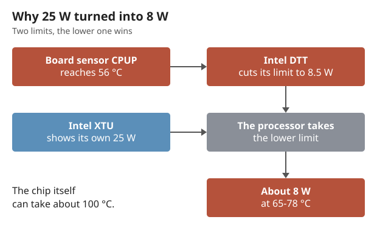
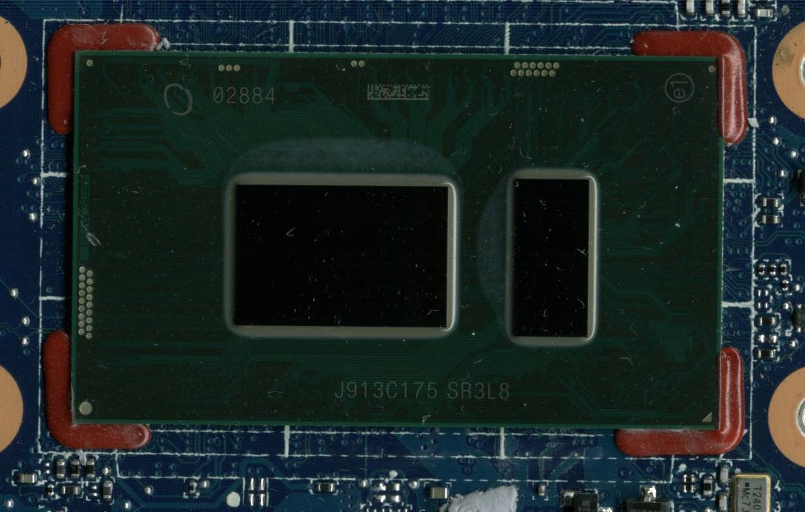
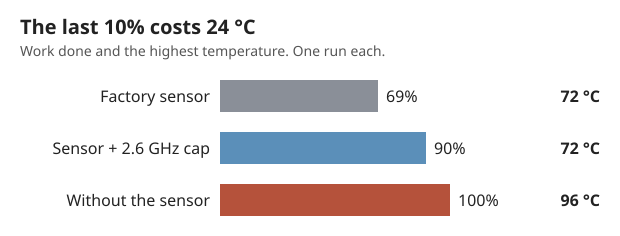
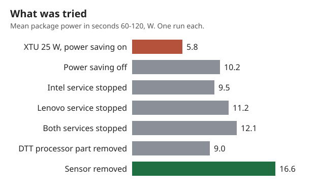
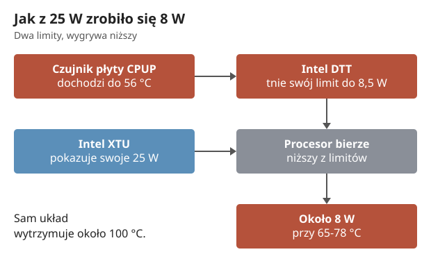
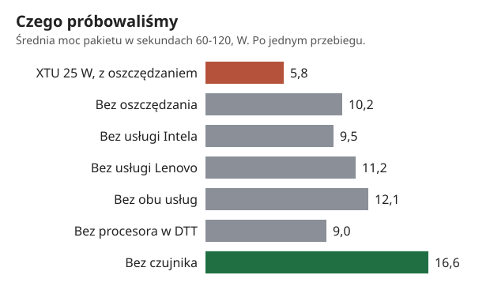

<div id="english" class="post-language" lang="en" markdown="1">
**TLDR:** My shelved tablet is usable again. Under long load its processor now runs at about four times the clock speed it had before, and I did not have to open the case.

## Good hardware I could not work on

My ThinkPad X1 Tablet Gen 3 has a four-core processor, 16 GB of memory and a fast SSD. That should be enough for years of work. It came from a sell-off of US stock and its screen scratched easily, but a 3MK protective glass took care of that. The processor was the real problem.

Under heavier load the tablet was fast only for a moment. Then it slowed down, at worst to 0.7 GHz. I tried to fix it several times and lost many days on it. ThrottleStop, a popular tool for such problems, changed nothing and reported no error. In the end I put a working computer away.

Years later I came back to it with the help of AI. It turned out that the processor never had to slow down like that. Intel software watched a sensor on the motherboard. When the sensor reached 56 °C, the software cut the processor's power to about 8 W, although the limit was set to 25 W. With that sensor removed from the system, the processor held about 3 GHz in tests.


## Setting 25 W was not enough

This processor has four cores, yet Intel gave it the same 15 W as the two-core model before it. That is enough for the base clock, not for four cores at turbo speed. So the laptop maker decides how fast it really is, with power limits and temperature settings. In [Notebookcheck's tests](https://www.notebookcheck.net/Unpleasant-surprise-Core-i5-Lenovo-ThinkPad-X1-Tablet-25-faster-than-i7-SKU.394986.0.html) the weaker version of this tablet, with an i5, was faster than the one with an i7.

A power limit says how much energy the processor may use, and so how fast it can work. There are two such limits, and the lower one applies. The user sets the first one. Lenovo's BIOS starts it at 8.5 W, well below the processor's nominal 15 W. With the help of AI I raised it to 25 W in Intel XTU, the most Intel allows for this processor, and I wanted those 25 W to hold under load. Intel's thermal driver changes the second one on its own, and XTU does not show it. That second limit is where the tablet stayed hurt: it also starts at 8.5 W, the driver raises it while a sensor on the board stays below 56 °C, and drops it back to 8.5 W once the sensor reaches 56 °C.

Lenovo chose the 56 °C threshold. It is that low because it is the temperature of the board, and its job is to protect the case. The processor itself can take about 100 °C, so it was slowing down with plenty of headroom left.



<details markdown="1">
<summary>For geeks: numbers and sources on 8th-generation U processors</summary>



*The same processor model, not my unit: [Intel Core i7-8650U, SR3L8](https://commons.wikimedia.org/wiki/File:Intel_core_i7-8650u_sr3l8.jpg) by Rjluna2, [CC BY-SA 4.0](https://creativecommons.org/licenses/by-sa/4.0/), unchanged.*

Intel put four cores where two had been and kept the 15 W ([i7-7600U](https://www.intel.com/content/www/us/en/products/sku/97466/intel-core-i77600u-processor-4m-cache-up-to-3-90-ghz/specifications.html), [i7-8650U](https://www.intel.com/content/www/us/en/products/sku/124968/intel-core-i78650u-processor-8m-cache-up-to-4-20-ghz/specifications.html)):

<div class="table-responsive" markdown="1">

| | i7-7600U, 7th gen | i7-8650U, 8th gen |
|---|---|---|
| Cores / threads | 2 / 4 | 4 / 8 |
| TDP | 15 W | 15 W |
| Base clock | 2.8 GHz | 1.9 GHz |
| Configurable up | 25 W at 2.9 GHz | 25 W at 2.1 GHz |
{: .table}

</div>

15 W pays for the base clock, not for four cores in turbo. So the laptop maker decides how fast the chip really is, with power limits and thermal policies. A short turbo spike spends the heat budget, then the cut comes.

- The weaker variant of this very tablet won: in 50 Cinebench loops the [i5-8250U averaged 550 points, the i7-8550U 440](https://www.notebookcheck.net/Unpleasant-surprise-Core-i5-Lenovo-ThinkPad-X1-Tablet-25-faster-than-i7-SKU.394986.0.html). Notebookcheck blamed turbo heat and Lenovo's unbalanced power management.
- Their i5 tablet started at 29 W, hit 98 °C and [averaged 17.5 W over an hour, with 49 °C on the back](https://www.notebookcheck.net/Lenovo-ThinkPad-X1-Tablet-2018-i5-3K-IPS-Convertible-Review.394881.0.html).
- It is not only Lenovo. An i7-8550U ASUS [ZenBook 13 fell to 0.8 GHz](https://www.notebookcheck.net/Asus-ZenBook-13-UX331UN-i7-8550U-MX150-Laptop-Review.277586.0.html) under combined CPU and GPU load, an i7-8650U [Surface Book 2 lost 25% by the fourth loop](https://www.notebookcheck.net/Surface-Book-2-suffers-from-performance-throttling-charging-abnormalities-and-slower-response-times.264060.0.html), while a [T480 with 25-29 W limits held 2.9-3.2 GHz](https://www.notebookcheck.net/A-performance-comparison-of-all-new-ThinkPad-notebooks.286486.0.html).
- TDP was no ceiling at AMD either: mobile Ryzen may [boost above it within a skin-temperature limit](https://github.com/sibradzic/stapmlifier) (STAPM), and the laptop maker sets much of the real envelope.
- The integrated GPU draws from the same budget. I saw the CPU drop below 1 GHz here with the iGPU at 100% (observed, not logged).

</details>

<details markdown="1">
<summary>For geeks: the layers of limits, down to the bits</summary>

<div class="table-responsive" markdown="1">

| Layer | Where | Who writes it | Can you change it? |
|---|---|---|---|
| MSR | `MSR_PKG_POWER_LIMIT`, 0x610 | BIOS at boot, XTU, DTT as a fallback | Yes, with the XTU SDK |
| MMIO | MCHBAR+0x59A0 (PL1), +0x59A4 (PL2) | BIOS at boot, then Intel DTT | Not from signed user tools. So change what DTT reacts to |
| Embedded controller | firmware of the laptop | some makers | No easy way. Not the case here |
| Windows | power mode, Energy saver, boost mode, clock cap | you | Yes, with Settings and powercfg |
{: .table}

</div>

**The effective limit is the lowest of them.** XTU reads back only the MSR, so its 25 W proves nothing.

The chain on this tablet:

1. The BIOS boots with PL1 = 8.5 W and PL2 = 29 W. Its thermal table (PSVT) gives the board thermistor `ACPI\INT3403\CPUP` a trip of 56 °C.
2. Intel DTT 8.7 runs Passive Policy 2 inside the UMDF driver (`esif_umdf2.dll` in WUDFHost), not in `esifsvc`. That is why stopping services did nothing.
3. While CPUP is below 56 °C the policy writes 29 W (raw 0xE8, units of 1/8 W) to the MMIO PL1.
4. At 56 °C it writes 8.5 W, then probes every 5 seconds in steps of 0.5 W, between 8.5 and about 14.5 W.
5. Without CPUP the policy has no hot-side input and does not trip. The last value written stays, so the sensor has to go while that value is high.
6. The cap becomes min(MSR 25 W, MMIO 29 W) = 25 W, and cooling stops the chip below it, at about 100 °C Tjmax.
7. Without the processor participant of DTT the 8.5 W of the BIOS applies. **Remove the sensor, never DTT itself.**

MSR 0x610, for reading it on Linux or in a debugger (the power unit is in 0x606 bits 3:0, W = 1/2^unit):

<div class="table-responsive" markdown="1">

| Bits | Meaning |
|---|---|
| 14:0 | PL1 |
| 15 | PL1 enabled |
| 16 | PL1 clamp |
| 23:17 | tau, the PL1 window |
| 46:32 | PL2 |
| 47 | PL2 enabled |
| 63 | lock until reset |
{: .table}

</div>

PL1 and PL2 are power limits. Setting them to 25 W does not switch the cTDP level or its base clock.

</details>

<details markdown="1">
<summary>For geeks: find the sensor that cuts your processor</summary>

This works without a third-party driver: DTT reports its own decisions through ETW.

```powershell
# Admin. Start the trace, run the load test in another window, then press on.
$dir = Join-Path $env:TEMP 'x1-trace'; New-Item -ItemType Directory -Force $dir | Out-Null
'DptfCpuEtwProvider', 'DptfAcpiEtwProvider', 'EsifLfEtwProvider', 'EsifUmdf2EtwProvider', 'DPTF', 'Lenovo-Thermal-Service' |
  Set-Content "$dir\providers.txt" -Encoding ASCII
logman start x1dtt -pf "$dir\providers.txt" -o "$dir\dtt.etl" -ets
Start-Sleep -Seconds 130
logman stop x1dtt -ets
tracerpt "$dir\dtt.etl" -o "$dir\dtt.csv" -of CSV -y
```

```powershell
# Decode the trace: 0x59a0 = PL1, 0x59a4 = PL2, raw value / 8 = watts.
$csv = Join-Path $env:TEMP 'x1-trace\dtt.csv'
$prev = ''
Get-Content $csv | ForEach-Object {
  $line = $null
  if ($_ -match 'offset (0x59a[04])\[14:0\] = (0x[0-9a-fA-F]+)') {
    $line = '{0} = {1} W' -f $Matches[1], ([Convert]::ToInt32($Matches[2], 16) / 8)
  } elseif ($_ -match '(\w+) D0: TEMPERATURE = (\d+)') {   # every sensor, not only CPUP
    $line = '{0} = {1:N1} C' -f $Matches[1], ($Matches[2] / 10 - 273.15)
  }
  if ($line -and $line -ne $prev) { $line; $prev = $line }
}
```

A cut looks like one sensor reaching its trip, followed at once by `0x59a0` falling. Here it was `CPUP`, about 56 °C, and a fall towards 8.5 W. That sensor's instance id is what `discover.ps1` lists and what `install.ps1 -Sensor` takes.

- Limit writes without such a trigger: another policy or program. Search the CSV for `SET_RAPL_POWER_LIMIT` and `Policy`.
- No limit writes at all, both limits high, the power-limit flag set: suspect the embedded controller. This method will not help.
- Newer platforms call DTT "IPF" and may use other provider names and offsets. `logman query providers` lists yours.

</details>


## The fix costs some protection

Two changes helped: switching off Windows power saving, which was also cutting the power, and removing the sensor from the system. Switching off power saving alone was not enough: in a two-minute test the processor reached 2.1 GHz, but under everyday load it fell to about 1.1 GHz and the tablet was unusable. It held 2.1 GHz only for browsing with nothing but the essentials open. The sensor stays on the board and can be brought back. Now cooling sets the speed. The processor reaches 96 °C at about 17 W, so 25 W is only an upper bound.


**This sensor protected the case from overheating.** Without it the tablet can get too hot, and heat also shortens the life of the battery. I have not measured how large that risk is. Without the sensor, don't hold the tablet in your hands under load. When you unplug the charger, my service brings the sensor back by itself within a few seconds. It has not yet passed one test: unplugging the charger under full load.

The safer choice is to keep the sensor and cap the clock at 2.6 GHz. In a test the tablet was then only 10% slower than without the sensor, and the processor ran at 72 °C instead of 96 °C.



<details markdown="1">
<summary>For geeks: every measurement, also the failures</summary>



Eight threads, mains, package power averaged over seconds 60-120, one run each, in the order they were tried:

<div class="table-responsive" markdown="1">

| Tried | Mean | Lowest after 30 s | Hottest |
|---|---|---|---|
| XTU 25 W, power saving on | 5.8 W | 4.1 W | 79 °C |
| XTU 25 W, power saving on, Best performance chosen (overridden) | 6.7 W | 4.0 W | 75 °C |
| Power saving off, Best performance | 10.2 W | 7.3 W | 96 °C |
| The same, traced with ETW | 8.9 W | 7.6 W | 96 °C |
| esifsvc stopped | 9.5 W | 8.3 W | 76 °C |
| Lenovo LITSSVC stopped | 11.2 W | 8.1 W | 96 °C |
| Both services stopped | 12.1 W | 7.7 W | 96 °C |
| Disable CPUP (refused by Windows) | 9.5 W | 7.9 W | 97 °C |
| DTT processor participant removed | 9.0 W | 8.1 W | 68 °C |
| **CPUP removed** | **16.6 W** | **14.9 W** | **97 °C** |
{: .table}

</div>

The three setups that were compared for work:

<div class="table-responsive" markdown="1">

| Setup | Power | Clock | Temperature, max | Work/s |
|---|---|---|---|---|
| 25 W, sensor active | 8.4 W | 2.1 GHz | 72 °C | 5410 |
| Turbo capped at 2.6 GHz | 11.4 W | 2.6 GHz | 72 °C | 7059 |
| 25 W, sensor removed | 16.6 W | 3.0 GHz | 96 °C | 7864 |
{: .table}

</div>

- At the start the CPU settled at 4.4 W and 36-42% of its nominal 2.112 GHz (the value Windows reports; Intel's base clock is 1.9 GHz), so 0.76-0.89 GHz. Work was not recorded then, the 4× is a ratio of clocks. In the three rows above work follows the clock within a few per cent.
- A later six-minute run after a reboot: 16.7 W on average, worst 10 seconds 15.6 W, about 3 GHz, 96 °C, no cut. Two minutes more: 17.2 W and 3.2 GHz. Short dips reach 13.8 W.
- From cold the first minute runs at 19-21 W, then the heat path sets the pace.
- All of it predates the current automation. Except where marked, it was measured with Best performance. Boost mode was not read during the runs (it is 4 now). Balanced was not measured.
- The next gain is cooling, not software: a repaste (a phase-change pad such as PTM7950) should bring the sustained power towards the 25 W cap. Then compare 20 W with 25 W: if the sustained clock is the same, keep 20 W.

</details>

<details markdown="1">
<summary>For geeks: dead ends, so that you can skip them</summary>

<div class="table-responsive" markdown="1">

| Route | What happened, or why not |
|---|---|
| XTU limits alone | MSR only, DTT still cuts |
| ThrottleStop | No effect and no error for me, cause unknown. Its own driver loaded, but its protocol is undocumented |
| Universal x86 Tuning Utility | Failed without an error: Defender quarantined its `WinRing0x64.sys`, a vulnerable driver (CVE-2020-14979) |
| Writing MMIO through WinRing0 | A known privilege-escalation hole, and the build I tried cannot reach this address |
| Stopping esifsvc and LITSSVC | 9-12 W: the policy lives in the driver |
| Disabling CPUP in Device Manager | Not supported, the DTT nodes cannot be disabled. They can be removed |
| Removing the processor participant | The BIOS limit applies: 8.5-9 W |
| cTDP or thermal settings in BIOS WMI | None exposed |
| Undervolting | XTU controls 34, 79 and 83 are read-only: the Plundervolt fix (CVE-2019-11157) |
| `setup_var` / RU.efi, BIOS downgrade | Researched, not done. Other models needed an old BIOS, and rollback may be blocked |
| Modified BIOS | Not done: signed capsules, and a brick needs a hardware programmer |
| DTT data-vault override of the 56 °C trip | Not done. It would be cleaner, but the vault is hashed |
{: .table}

</div>

Plan B, untested on this tablet: Linux can write both limits without a third-party driver, through `/sys/class/powercap` (`intel-rapl:0` is MSR, `intel-rapl-mmio:0` is MMIO). [throttled](https://github.com/erpalma/throttled) does it periodically. Don't run `thermald --adaptive`, it applies the same thermal table. Check bit 63 of 0x610 first.

</details>


## One AI found the cause, the other the fix

I started with the AI model GLM, which was the first to suspect Intel's thermal driver. Anthropic's Claude found the cause. It would not raise the limit with a driver that has full access to the system (ring 0), though, because that meant getting around Microsoft Defender. Defender blocks this driver because of a known vulnerability. Then the safeguard, Anthropic's safety filter, began to interrupt Claude's answers.

So I went back to GLM. It tried that driver without success and undid its change to Defender. Then it found a simpler way: remove the sensor. Weakening Defender turned out to be unnecessary.

<details markdown="1">
<summary>For geeks: who did what, and what exactly was stopped</summary>

From the session logs, Warsaw time. Claude drafted this section, so note that it describes its own maker's safeguard.

<div class="table-responsive" markdown="1">

| When | Who | What happened |
|---|---|---|
| 17 Nov, 11:33 | GLM-5.3, high | The start. It led to 25 W in XTU, which turned out to be only one of the two limits |
| 21 Nov, 20:34-21:00 | Claude Opus 5.5 | ETW trace: DTT, the CPUP sensor, 56 °C, 8.5 W. It removed the processor participant, which did not help, and concluded that 15 W was out of reach on Windows under its rules |
| 21:23 | Safeguard | Stopped an answer during work on the throughput test |
| 21:44 | Safeguard | Flagged the session, Opus 4.8 answered instead |
| 21:49, 21:50 | Safeguard | Stopped the answers to my request for a sustained 20-25 W, and to the same request with my reasons |
| 21:54 | Safeguard | Stopped a check of the hash inside a DTT configuration file |
| 21:57, 21:58 | Safeguard | Stopped the request to document the findings, flagged the session again. Opus 4.8 wrote the document |
| 22:03 | Safeguard | Stopped the sixth answer, during the clock-cap tests |
| 22:10 | GLM-5.3, max | Took over, with that document |
| 22:34 | GLM-5.3, max | Removed CPUP |
{: .table}

</div>

- The safeguard is a classifier outside the conversation. It gave no reason for any single stop. Its notice admits that it can flag work unrelated to cybersecurity.
- Separately, Claude itself refused to get WinRing0 past Defender. GLM did try that, with a Defender exclusion. It was a dead end, and GLM removed the driver and the exclusion the same evening. The fix needed neither, so don't copy that step.
- The safeguard is not the whole reason: before the first stop Claude had the cause and had not thought of removing that sensor. Whether it would have got there without the stops, nobody knows.

</details>

<details markdown="1">
<summary>For geeks: what I learned as a software engineer</summary>

The AI needed a measurable goal. In short (a summary, not my exact words):

> Under sustained load, reach the maximum power the cooling allows, but no more than 25 W.

"Fix the throttling" lets an agent stop at a readback of 25 W. This goal can only be proven under load.

In my view GLM would have managed without Claude once success was defined.


- Define success as a measurement under load, and what must not get worse.
- A readback proves a write, not an effect. Two writers of one value mean that the lower or later one wins.
- A symptom is not a cause: below 1 GHz had three causes here (power plan, power limit, shared GPU budget).
- Security software is an invisible failure domain: a blocked driver fails without an error.
- A vendor's signed service with an API beats a reverse-engineered driver.
- The wrapper is the feature: retries for a service that wakes up late, a log, a readback, an undo.
- What runs as SYSTEM must live where only administrators can write, its owner included.
- Full load starves normal-priority helpers: a scheduled task (priority 7) reacted after minutes.
- Keep scripts ASCII: PowerShell 5.1 reads UTF-8 without BOM as ANSI, and my Polish name broke paths in ThrottleStop.

</details>


## Check your laptop before you throw it away

Another laptop with an Intel processor may have a similar problem. On mains, load the processor fully for two minutes and watch its power and temperature (the script is in the collapsed section "measure your own machine" below). If it reaches about 95 °C, it needs better cooling. If it stays clearly cooler while the power falls far below the limit, something is holding it back.

Don't attempt the fix with a swollen battery or a broken fan, on someone else's hardware, or if you care about the warranty.

I hold it against Lenovo that it lazily left this problem to its users. When working computers are thrown away, the environment pays too.

<details markdown="1">
<summary>For geeks: measure your own machine</summary>

Start here on any laptop. The first script only reads. The second loads the CPU fully.

**`discover.ps1`**: processor, BIOS, XTU, VBS, power mode and the DTT sensors present.

```powershell
# discover.ps1 - read-only, no admin. Run it first, on any Windows laptop with an Intel CPU.
$cpu = Get-CimInstance Win32_Processor
'CPU:        {0} ({1} cores, {2} threads, nominal {3} MHz)' -f $cpu.Name.Trim(), $cpu.NumberOfCores, $cpu.NumberOfLogicalProcessors, $cpu.MaxClockSpeed
'Machine:    ' + (Get-CimInstance Win32_ComputerSystem).Manufacturer + ' ' + (Get-CimInstance Win32_ComputerSystem).Model
'BIOS:       ' + (Get-CimInstance Win32_BIOS).SMBIOSBIOSVersion
'Windows:    ' + [Environment]::OSVersion.Version
$dll = 'C:\Program Files\Intel\Intel(R) Extreme Tuning Utility\Client\IntelOverclockingSDK.dll'
'XTU SDK:    ' + $(if (Test-Path $dll) { [Diagnostics.FileVersionInfo]::GetVersionInfo($dll).FileVersion } else { 'not installed' })
$dg = Get-CimInstance -Namespace root\Microsoft\Windows\DeviceGuard -ClassName Win32_DeviceGuard -ErrorAction SilentlyContinue
'VBS:        status={0} (2 = running), Memory integrity={1}' -f $dg.VirtualizationBasedSecurityStatus, [bool]($dg.SecurityServicesRunning -contains 2)
Add-Type -Namespace X1Find -Name Power -MemberDefinition @'
[DllImport("powrprof.dll")] public static extern uint PowerGetEffectiveOverlayScheme(out Guid g);
'@
$g = [Guid]::Empty
[void][X1Find.Power]::PowerGetEffectiveOverlayScheme([ref]$g)
"Power mode: $g (ded574b5-45a0-4f42-8737-46345c09c238 = Best performance)"
$pkg = $null
try { $pkg = (Get-Counter '\Energy Meter(RAPL_Package0_PKG)\Power' -ErrorAction Stop).CounterSamples[0].CookedValue / 1000 } catch { }
'Package W:  ' + $(if ($null -ne $pkg) { [math]::Round($pkg, 1) } else { 'no RAPL counter' })

'Intel DTT / DPTF / IPF participants (the sensor candidates are the Generic Participants):'
Get-PnpDevice -PresentOnly |
  Where-Object { $_.FriendlyName -match 'Dynamic Tuning|Dynamic Platform and Thermal|Innovation Platform Framework' } |
  Format-Table InstanceId, FriendlyName -AutoSize | Out-String -Width 160
```

**`loadtest.ps1`**: power, clock, temperature and work every 2 s, a CSV and a verdict.

```powershell
# loadtest.ps1 - no admin. Full load: the case gets hot. Mains only, one test at a time.
param(
  [int]$Seconds = 120,
  [double]$TargetW = 25,     # the limit you set
  [int]$ThermalC = 94,       # a few degrees below Tjmax (100 C on the i7-8650U)
  [string]$Csv = (Join-Path $env:TEMP ("loadtest-{0:yyyyMMdd-HHmmss}.csv" -f (Get-Date)))
)
Add-Type -TypeDefinition @'
using System; using System.Threading;
public static class X1Burn {
  static volatile bool stop; public static long Work;
  public static void Start(int n) {
    stop = false; Work = 0;
    for (int i = 0; i < n; i++) {
      var t = new Thread(() => { double x = 1.0001; while (!stop) {
        for (int k = 0; k < 100000; k++) { x = Math.Sqrt(x * 1.000001 + 0.5); }
        Interlocked.Increment(ref Work); } });
      t.IsBackground = true; t.Start();
    }
  }
  public static void Stop() { stop = true; }
}
'@
Add-Type -AssemblyName System.Windows.Forms
$nominal = (Get-CimInstance Win32_Processor).MaxClockSpeed / 1000
$names = '\Energy Meter(RAPL_Package0_PKG)\Power',
         '\Processor Information(_Total)\% Processor Performance',
         '\Thermal Zone Information(*)\Temperature'
"PASS: from s40 every 10 s window is at $ThermalC C+ or at $TargetW W, and never above $TargetW W on average."
$rows = @(); $lastWork = 0; $lastT = 0
$sw = [Diagnostics.Stopwatch]::StartNew()
[X1Burn]::Start([Environment]::ProcessorCount)
try {
  while ($sw.Elapsed.TotalSeconds -lt $Seconds) {
    $s = (Get-Counter $names -SampleInterval 2 -MaxSamples 1).CounterSamples
    $t = $sw.Elapsed.TotalSeconds; $work = [X1Burn]::Work
    $hottest = ($s | Where-Object Path -like '*thermal zone*' | Measure-Object CookedValue -Maximum).Maximum
    $r = [pscustomobject]@{
      t = [math]::Round($t); W = [math]::Round($s[0].CookedValue / 1000, 1)
      GHz = [math]::Round($s[1].CookedValue * $nominal / 100, 2); C = [math]::Round($hottest - 273.15)
      WorkPerS = [math]::Round(($work - $lastWork) / ($t - $lastT))
    }
    $lastWork = $work; $lastT = $t; $rows += $r
    '{0,4} s {1,6} W {2,6} GHz {3,4} C {4,7} work/s' -f $r.t, $r.W, $r.GHz, $r.C, $r.WorkPerS
    if ($r.C -ge 101 -or [Windows.Forms.SystemInformation]::PowerStatus.PowerLineStatus -ne 'Online') { 'ABORTED'; break }
  }
} finally { [X1Burn]::Stop() }

$rows | Export-Csv -Path $Csv -NoTypeInformation
$late = @($rows | Where-Object t -ge 60)
if ($late.Count -lt 5) { "too short to judge: run at least 100 s | pass=False | csv: $Csv"; return }
$mean =($late | Measure-Object W -Average).Average
$short = @($rows | Where-Object t -ge 40 | Where-Object {
  $end = $_.t; $win = $rows | Where-Object { $_.t -gt $end - 10 -and $_.t -le $end }
  ($win | Measure-Object W -Average).Average -lt ($TargetW - 1) -and ($win | Measure-Object C -Maximum).Maximum -lt $ThermalC
})
$ok = $rows[-1].t -ge ($Seconds - 2) -and $mean -le ($TargetW + 0.5) -and $short.Count -eq 0
'from s60: {0:N1} W, {1:N2} GHz, {2:N0} work/s | windows short of both limits={3} | pass={4}' -f `
  $mean, ($late | Measure-Object GHz -Average).Average, ($late | Measure-Object WorkPerS -Average).Average, $short.Count, $ok
"csv: $Csv"
```

How to read it:

- Power at the limit you set: done, that limit is all there is.
- Power below it and the CPU near its maximum temperature: cooling is the limit. Software has nothing left to give.
- Power far below it and a cool CPU under full load: **someone is cutting. This is the case worth fixing.**
- Low clocks with low CPU usage are just the power plan.
- A fixed number of watts is the wrong pass mark, because cooling changes. Short dips at the thermal limit are fine.
- Counter names are localised on some Windows installations. No RAPL counter: read package power from XTU.

</details>

<details markdown="1">
<summary>For geeks: unblock your own processor</summary>

Tested on one machine. The method should carry over to Intel laptops where DTT or DPTF does the cutting, above all the 8th-generation U series: i5-8250U, i5-8350U, i7-8550U, i7-8650U.

**Don't even try when:**

- the battery is swollen or damaged, the fan is dead or the machine shuts down under load,
- the load test already ends at the maximum temperature: clean and repaste instead,
- the machine belongs to an employer or is still under a warranty you need,
- it is an AMD: the limits, tools and sensors here are Intel's,
- XTU will not start or shows PL1 and PL2 as read-only,
- the trace points to the embedded controller,
- the only candidate sensor protects the battery, the charger or the skin of a device you hold, whatever its name (here `CHRG` is the charger). The trace proves which sensor trips, not what it protects,
- you use it on your lap or in your hands under long load, or it has no fan,
- you cannot keep an eye on it during the tests or cannot afford to lose what is on it.

Watch the charger too. This tablet came with 45 W or 65 W and has a 42 Wh battery. If the battery drains on mains under load, lower the limit.

**The ladder. Test after every step and stop when cooling becomes the limit:**

1. `discover.ps1`, then a baseline `loadtest.ps1`. Write the numbers down.
2. Energy saver off, Best performance. Here the clock went from 0.76-0.89 to 2.1 GHz, but those runs are from different days, so not all of it is proven to come from this step. In everyday work it stayed at about 1.1 GHz (my observation, not logged).
3. Calmer turbo and, if needed, a clock cap (the commands below). It keeps every protection. Here 2.6 GHz gave 90% of the final work at 72 °C.
4. Look up the cTDP-up of your exact CPU on Intel's specification page. That is your ceiling, not 25 W by default.
5. `controls.ps1`: confirm that PL1, PL2 and tau can be changed, and note their ids and boot values.
6. Set the limits by hand and test. Still cut with a cool CPU? Trace it.
7. Remove only the sensor the trace proved, by hand, while cool and on mains. Test, then bring it back with `pnputil /scan-devices` and see the cut return. That is your proof.
8. Only then automate: `install.ps1 -Sensor '...' -Watts ... -Tau ...`. The service assumes the ids 48, 47 and 66.

**Knobs that need no driver and keep the protections:**

```powershell
# Admin. Note the current values first.
powercfg /qh SCHEME_CURRENT SUB_PROCESSOR PERFBOOSTMODE
powercfg /qh SCHEME_CURRENT SUB_PROCESSOR PROCFREQMAX

# Calmer turbo: 4 = Efficient Aggressive, 2 = default here, 0 = turbo off (the last resort).
powercfg /setacvalueindex SCHEME_CURRENT SUB_PROCESSOR PERFBOOSTMODE 4
powercfg /setdcvalueindex SCHEME_CURRENT SUB_PROCESSOR PERFBOOSTMODE 4

# Clock cap in MHz, 0 = none. Try a few and keep the one with the most work/s.
powercfg /setacvalueindex SCHEME_CURRENT SUB_PROCESSOR PROCFREQMAX 2600
powercfg /setactive SCHEME_CURRENT
```

**`controls.ps1`**: what XTU can change and read on your machine, with ids.

```powershell
# controls.ps1 - read-only, elevated. What does XTU let you change and read on this machine?
$dll = 'C:\Program Files\Intel\Intel(R) Extreme Tuning Utility\Client\IntelOverclockingSDK.dll'
$lib = [Activator]::CreateInstance([Reflection.Assembly]::LoadFrom($dll).GetType('Intel.Overclocking.SDK.IntelOverclockingLibrary'))
$lib.Initialize()
if (-not $lib.InitializeCheck()) { throw 'XTU SDK not ready.' }
'--- controls (PL1=48, PL2=47, tau=66 here; check the names on your machine)'
$lib.TuningLib.GetAvailableControls() | Sort-Object Id | Select-Object * | Format-List | Out-String -Width 160
'--- monitors'
$m = $lib.MonitoringLib
$m.Start()
Start-Sleep 3
foreach ($x in ($m.GetAvailableMonitors() | Sort-Object Id)) {
  $v = try { $m.GetValue([uint32]$x.Id) } catch { '?' }
  '{0,10} | {1,-45} | {2,10} {3}' -f $x.Id, $x.Name, $v, $x.Units
}
$m.Stop()
```

**Prompt for an AI agent, for any laptop:**

```plaintext
My Intel laptop throttles under sustained load. Help me unblock it with the method from
https://blog.ww86.eu/hardware/2026/11/19/x1-tablet-25w-throttling.html
Read the whole post, with every collapsed section. It was tested on a different machine,
so treat its values as examples, not as facts about mine.

Success: under sustained load, the maximum power my cooling allows,
but no more than the cTDP-up Intel lists for my exact CPU.

Phase 1, read-only: run discover.ps1, check my CPU against the "Don't even try" list,
and tell me if you would stop here and why. Then wait for my answer.
Phase 2, after my yes: baseline load test, then the ladder, one step at a time.
Before each change: one sentence on what it does and the exact undo. Wait for my yes.
After each change: the same load test, and a table of before and after.

Hard limits: no third-party ring0 drivers, no Defender exclusions, no BIOS changes.
Never remove a battery or charger sensor, the DTT manager or its processor participant.
Never remove a sensor the trace has not proved. A readback is not proof, only load is.
```

</details>

<details markdown="1">
<summary>For geeks: reported upstream, and others with the same problem</summary>

- Universal x86 Tuning Utility: [tuning fails silently without its driver](https://github.com/JamesCJ60/Universal-x86-Tuning-Utility/issues/408).
- ThrottleStop: [broken Polish letters in paths and other bugs](https://www.techpowerup.com/forums/threads/ts-9-7-i7-8650u-win11-24h2-ini-mojibake-non-ascii-username-tpl-window-not-uia-accessible-driver-ioctls-winring0.354938/).
- Pengwin, found on the way: [a login script swallows stdin](https://github.com/WhitewaterFoundry/Pengwin/issues/818).

Old threads where people hit the same wall. If this post solved yours, tell them:

- X1 Tablet Gen 3: [TDP throttle](https://www.reddit.com/r/thinkpad/comments/fz46i8/) and [lower PL after a BIOS update](https://www.reddit.com/r/thinkpad/comments/t5oen0/)
- X1C6, T480, T480s, X1 Yoga: [throttling concerns](https://www.reddit.com/r/thinkpad/comments/7xyrtv/)
- Surface Book 2: [is there any way to fix it](https://www.reddit.com/r/Surface/comments/15ht4m8/)
- HP Spectre and others: [stuck in TDP down](https://www.reddit.com/r/eGPU/comments/8kanqw/)
- Dell XPS 13 9360, an embedded-controller case: [still PL1 throttling](https://www.techpowerup.com/forums/threads/still-experiencing-pl1-throttling.296530/)

</details>

<details markdown="1">
<summary>For geeks: it throttles again</summary>

**Rebuild it with an AI.** The whole fix, code included, is in the sections below. For this tablet, give your agent this (other laptops have their own prompt in "unblock your own processor"):

```plaintext
Success: under sustained load, the maximum power the cooling allows,
but no more than 25 W.
My ThinkPad X1 Tablet Gen 3 throttles again. Read the whole post, including
the collapsed sections:
https://blog.ww86.eu/hardware/2026/11/19/x1-tablet-25w-throttling.html
Start read-only: run the check, look for what changed, tell me what you found.
Ask before the load test and before every change, and give me a rollback.
No third-party ring0 drivers, no Defender exclusions, nothing above 25 W.
```


Order: check, what changed, load test, table, trace. Change things last and ask the owner before a change, a reboot or stopping a service. Run one load test at a time, never while someone else is tuning.

**State, read-only**

```powershell
# Read-only, no admin needed.
Add-Type -Namespace X1 -Name Power -MemberDefinition @'
[DllImport("powrprof.dll")] public static extern uint PowerGetEffectiveOverlayScheme(out Guid g);
'@
$g = [Guid]::Empty; [void][X1.Power]::PowerGetEffectiveOverlayScheme([ref]$g)
"CPU:          " + (Get-CimInstance Win32_Processor).Name
"BIOS:         " + (Get-CimInstance Win32_BIOS).SMBIOSBIOSVersion
"last boot:    " + (Get-CimInstance Win32_OperatingSystem).LastBootUpTime
"battery:      " + (Get-CimInstance Win32_Battery).BatteryStatus + " (2 = mains; 1, 4, 5 = discharging)"
"power mode:   $g (for a load test expect ded574b5-45a0-4f42-8737-46345c09c238 = Best performance)"
"CPUP present: " + [bool](Get-PnpDevice -InstanceId 'ACPI\INT3403\CPUP' -ErrorAction SilentlyContinue | Where-Object Present)
Get-Service TdpModeService, XTU3SERVICE, esifsvc, LITSSVC -ErrorAction SilentlyContinue | Format-Table Name, Status
Get-Process mode-watch, ThrottleStop -ErrorAction SilentlyContinue | Format-Table Name, Id
Get-ScheduledTask -TaskName 'TDP*' -ErrorAction SilentlyContinue | Format-Table TaskName, State
Get-CimInstance Win32_PnPSignedDriver | Where-Object DeviceName -match 'Dynamic Tuning' |
  Sort-Object DeviceName -Unique | Format-Table DeviceName, DriverVersion
```

Without admin some tasks are invisible. An empty list is no proof that there are none.

**What was installed or updated**

```powershell
# Read-only. What was installed or updated in the last 14 days?
$since = (Get-Date).AddDays(-14)
@(
  Get-WinEvent -FilterHashtable @{ LogName = 'System'; StartTime = $since; ProviderName = 'Microsoft-Windows-WindowsUpdateClient'; Id = 19 } -ErrorAction SilentlyContinue
  Get-WinEvent -FilterHashtable @{ LogName = 'System'; StartTime = $since; Id = 7045 } -ErrorAction SilentlyContinue
) | Sort-Object TimeCreated -Descending |
  ForEach-Object { '{0:s} {1}' -f $_.TimeCreated, ($_.Message -replace '\s+', ' ') }
Get-WinEvent -FilterHashtable @{ LogName = 'Application'; StartTime = $since; ProviderName = 'MsiInstaller'; Id = 1033 } -ErrorAction SilentlyContinue |
  ForEach-Object { '{0:s} {1}' -f $_.TimeCreated, ($_.Message -replace '\s+', ' ') }
```

**Symptom, cause, action**

<div class="table-responsive" markdown="1">

| Symptom | Likely cause | Action |
|---|---|---|
| Turbo, then 8 W at 65-78 °C, CPUP present | The sensor is back: reboot, driver or Windows update, device rescan, resume | Find out what restored it, then, with consent, “Rebuild the fix from nothing” |
| 8 W from the first second, CPUP absent | A low MMIO limit was left behind when the sensor was removed | Let it cool, then, with consent, “Rebuild the fix from nothing” |
| A slide to 4-6 W at 53-57 °C | Energy saver or Best power efficiency, which override the chosen mode | Energy saver off, Best performance |
| Flat 15 W, below 95 °C | A limit left over from battery use, or XTU limits lost | Check the power source, set 25 W again |
| Flat 8.5-9 W, the DTT processor participant is missing | Without DTT the BIOS MMIO value applies | pnputil /scan-devices |
| Below 15 W at 96 °C, thermal flag set | Dust, dried paste, blocked vents, hot room | Cooling, not software |
| Limits differ from what was set | Another program writes them: XTU profiles, ThrottleStop, UXTU, Vantage, a new DTT | List recent changes, then trace |
| CPU below 1 GHz while the GPU is at 100% | The CPU and the iGPU share one package power budget | Find what loads the GPU: hardware acceleration, compositing |
| Low power and low CPU usage | No throttling, just no load | Run the load test |
| Switching takes minutes under load | Scheduled tasks default to priority 7, below normal | Task priority 4 or higher (a lower number) |
{: .table}

</div>

</details>

<details markdown="1">
<summary>For geeks: rebuild the fix from nothing</summary>

**Warning: this removes the manufacturer's protection of the case, so do it on mains only; on battery the service from step 3 brings the sensor back.** The undo is the next section.

All code is in this post. The one outside file is the XTU installer.

**Step 1. The software.**

- Intel DTT 8.7.10200.12510, the driver from Lenovo or Windows Update. Keep it.
- Intel XTU **7.4.1.3**. [Intel no longer offers old versions](https://www.intel.com/content/www/us/en/download/17881/intel-extreme-tuning-utility-intel-xtu.html), so keep a copy of the installer: 22,310,568 bytes, signed by Intel Corporation, SHA-256 `A6ABE038954FED536F60004DA0CAAEE80144EAEC1E1534AF930C891D167016D4`. Newer XTU was not tested here.
- Virtualization-based security was running and Memory integrity was off when this worked.
- The C# compiler is part of Windows. Nothing else to install.

```powershell
# Check an installer before running it: the hash and Valid / Intel Corporation.
$f = '.\xtusetup.exe'
(Get-FileHash $f -Algorithm SHA256).Hash
Get-AuthenticodeSignature $f | Format-List Status, SignerCertificate
```

**Step 2. By hand, to prove it works.** Switch Energy saver off in Settings first, then run this elevated, with the tablet cool and idle:

```powershell
# Admin, on mains, while the tablet is cool and idle. Energy saver must be off.
Add-Type -AssemblyName System.Windows.Forms
if ([Windows.Forms.SystemInformation]::PowerStatus.PowerLineStatus -ne 'Online') { throw 'Not on mains: keep the sensor.' }
Add-Type -Namespace X1 -Name Overlay -MemberDefinition @'
[DllImport("powrprof.dll")] public static extern uint PowerSetActiveOverlayScheme(Guid g);
'@
[void][X1.Overlay]::PowerSetActiveOverlayScheme([Guid]'ded574b5-45a0-4f42-8737-46345c09c238')

Start-Service XTU3SERVICE
$dll = 'C:\Program Files\Intel\Intel(R) Extreme Tuning Utility\Client\IntelOverclockingSDK.dll'
$asm = [Reflection.Assembly]::LoadFrom($dll)
$lib = [Activator]::CreateInstance($asm.GetType('Intel.Overclocking.SDK.IntelOverclockingLibrary'))
$lib.Initialize()
$t = $lib.TuningLib
$t.Tune([uint32]48, [decimal]25, $false)   # PL1, W
$t.Tune([uint32]47, [decimal]25, $false)   # PL2, W
$t.Tune([uint32]66, [decimal]28, $false)   # tau, s
$t.ApplyChanges($false)
48, 47, 66 | ForEach-Object { $t.GetControl([uint32]$_).ActiveValue }   # 25, 25, 28

pnputil /scan-devices                               # sensor back, DTT writes its cool-state 29 W
Start-Sleep -Seconds 20
pnputil /remove-device 'ACPI\INT3403\CPUP'          # sensor out, confirm the limit with a load test
```

Cool means CPUP well below 56 °C, as the trace shows it. After one hot restore the cut came back in about 18 s, inside the 20 s wait above. Removing the sensor then may leave the low limit behind (not proven).

Then run `loadtest.ps1`. If XTU fails to initialise, wait: its service can need a minute or more after boot. By hand it lasts until a reboot or a device scan. Re-plugging the charger or changing the power mode can reset the limits.

**Step 3. The automation.** Save `TdpModeService.cs` and `install.ps1` (below) side by side, ASCII, and run the installer elevated: `powershell -ExecutionPolicy Bypass -File .\install.ps1`

- On mains: the sensor goes after 90 s, once the CPU has been below 30% for the last 30 s. This does not prove that DTT has restored the high limit: the service does not read it, so a low one can stay behind.
- Load that starts before that keeps the factory behaviour: the CPU stays slow until it has had those 30 calm seconds. One 2-second sample at 30% restarts the count, so with normal background load that can take indefinitely.
- On battery, with an unknown source and when the service stops: the sensor comes back. It polls every 2 s.
- XTU gets 25 W / 25 W / 28 s every 10 minutes, in its own thread.
- Windows saves on battery with a 2.4 GHz cap. Boost mode 4 applies to both.

**How far it is tested:** this is a simpler rewrite of the service on my tablet, not the same code. It has no stuck-limit alarm and no backup watchdog. It compiles, its decision function passed 144 combinations of inputs and a 17-minute simulation with two unplugs, and it reads the real sensor state. **It has not yet been installed or run under load.**

Since 22 November 2026 my tablet runs different code, v1.4, from `C:\Program Files\TDP`, also not accepted yet. Older scripts are archived in `C:\ProgramData\TDP`. Look for both, and for `TDP-*` tasks, before blaming anything else. The installer below replaces that service and disables those tasks. If you write your own automation instead, it must:

- keep every file that SYSTEM runs, its folder, owner, backups and task writable by administrators only,
- restore the sensor first on battery, before touching XTU, and treat an unknown power source as battery,
- use one lock or one thread, and check the power source again after every wait and after removing the sensor,
- run at normal or higher priority, otherwise full load delays it for minutes,
- handle unplug, plug-in, resume, Fast Startup and a killed process, ignore battery percentage changes,
- not re-seat the sensor periodically: act only when the state is wrong,
- log the final state and return an error when a step fails,
- watch the power source during every start-up wait, and not leave the sensor out when it stops,
- pass a real test: unplug under full load, plug in, sleep, reboot.

**`TdpModeService.cs`**: the service.

```csharp
// TdpModeService.cs - keeps an unlocked power-limit setup. C# 5, builds with the compiler in Windows.
// Mains: one thermal sensor of Intel DTT is removed once the CPU has been calm.
// Battery, unknown source or service stop: the sensor comes back.
// XTU limits are re-applied every 10 minutes in a separate thread.
// Arguments: <sensor instance id> <watts> <tau seconds> [check]
using System;
using System.Diagnostics;
using System.Globalization;
using System.IO;
using System.Reflection;
using System.Runtime.InteropServices;
using System.ServiceProcess;
using System.Threading;

public enum Step { None, Restore, Remove }

public class TdpModeService : ServiceBase {
  public const int PollSeconds = 2;     // reaction to unplugging
  public const int SettleSeconds = 90;  // time for DTT to write its high limit
  public const int CalmSeconds = 30;    // do not remove the sensor in the middle of a cut
  public const double CalmBusy = 30;    // percent CPU

  const string XtuDll = @"C:\Program Files\Intel\Intel(R) Extreme Tuning Utility\Client\IntelOverclockingSDK.dll";

  [StructLayout(LayoutKind.Sequential)]
  struct PowerStatus { public byte AC, Flag, Percent, Reserved; public int Life, FullLife; }

  [DllImport("kernel32.dll")] static extern bool GetSystemPowerStatus(out PowerStatus s);
  [DllImport("kernel32.dll")] static extern bool GetSystemTimes(out long idle, out long kernel, out long user);
  [DllImport("cfgmgr32.dll", CharSet = CharSet.Unicode)]
  static extern int CM_Locate_DevNodeW(out uint node, string id, uint flags);

  readonly string sensor;
  readonly int watts, tau;
  readonly ManualResetEvent stop = new ManualResetEvent(false);
  readonly object logLock = new object();
  Thread sensorThread, xtuThread;
  long lastIdle, lastTotal;

  public TdpModeService(string sensor, int watts, int tau) {
    this.sensor = sensor; this.watts = watts; this.tau = tau;
    ServiceName = "TdpModeService";
  }

  // The whole policy. No state, so a missed event cannot leave it wrong.
  public static Step Decide(bool mains, bool present, int mainsSeconds, int calmSeconds) {
    if (!mains) return present ? Step.None : Step.Restore;
    if (present && mainsSeconds >= SettleSeconds && calmSeconds >= CalmSeconds) return Step.Remove;
    return Step.None;
  }

  static bool OnMains() {
    PowerStatus s;
    return GetSystemPowerStatus(out s) && s.AC == 1;   // unknown counts as battery
  }

  bool Present() {
    uint node;
    return CM_Locate_DevNodeW(out node, sensor, 0) == 0;
  }

  double Busy() {
    long idle, kernel, user;
    if (!GetSystemTimes(out idle, out kernel, out user)) return 100;
    long total = kernel + user;   // kernel time includes idle time
    long dt = total - lastTotal, di = idle - lastIdle;
    lastTotal = total; lastIdle = idle;
    return dt <= 0 ? 100 : 100.0 * (dt - di) / dt;
  }

  void Log(string message) {
    try {
      lock (logLock) {
        string dir = Path.Combine(AppDomain.CurrentDomain.BaseDirectory, "logs");
        Directory.CreateDirectory(dir);
        string file = Path.Combine(dir, "service.log");
        if (File.Exists(file) && new FileInfo(file).Length > 1048576) {
          File.Copy(file, file + ".old", true);
          File.Delete(file);
        }
        File.AppendAllText(file, DateTime.Now.ToString("s") + " " + message + Environment.NewLine);
      }
    } catch { }   // logging must never stop the sensor loop
  }

  int Pnputil(string arguments, int timeoutMs) {
    var info = new ProcessStartInfo(Path.Combine(Environment.SystemDirectory, "pnputil.exe"), arguments);
    info.UseShellExecute = false;
    info.CreateNoWindow = true;
    using (Process p = Process.Start(info)) {
      p.PriorityClass = ProcessPriorityClass.High;   // full load must not delay the sensor
      if (p.WaitForExit(timeoutMs)) return p.ExitCode;
      p.Kill();
      return -1;
    }
  }

  void Restore(string why) {
    int code = Pnputil("/scan-devices", 10000);
    Log("restore (" + why + ") exit=" + code + " present=" + Present());
  }

  void Remove() {
    if (stop.WaitOne(0) || !OnMains()) return;
    int code = Pnputil("/remove-device \"" + sensor + "\"", 4000);
    Log("remove exit=" + code + " present=" + Present());
    if (!OnMains()) Restore("unplugged during removal");
  }

  void SensorLoop() {
    int mainsSeconds = 0, calmSeconds = 0;
    string last = "";
    Busy();
    while (!stop.WaitOne(PollSeconds * 1000)) {
      try {
        bool mains = OnMains(), present = Present();
        double busy = Busy();
        mainsSeconds = mains ? Math.Min(mainsSeconds + PollSeconds, 86400) : 0;
        calmSeconds = mains && busy < CalmBusy ? Math.Min(calmSeconds + PollSeconds, 86400) : 0;
        string now = "mains=" + mains + " sensor=" + present;
        if (now != last) { Log(now); last = now; }
        Step step = Decide(mains, present, mainsSeconds, calmSeconds);
        if (step == Step.Restore) Restore("battery");
        if (step == Step.Remove) Remove();
      } catch (Exception e) { Log("sensor loop: " + e.Message); }
    }
  }

  static object Call(object target, string name, params object[] args) {
    return target.GetType().InvokeMember(name, BindingFlags.InvokeMethod, null, target, args);
  }

  void XtuLoop() {
    object lib = null;
    do {
      int wait = 60;
      try {
        if (lib == null) {
          Type type = Assembly.LoadFrom(XtuDll).GetType("Intel.Overclocking.SDK.IntelOverclockingLibrary");
          object fresh = Activator.CreateInstance(type);
          Call(fresh, "Initialize");
          if (!(bool)Call(fresh, "InitializeCheck")) throw new Exception("XTU is not ready");
          lib = fresh;
        }
        object t = lib.GetType().InvokeMember("TuningLib", BindingFlags.GetProperty, null, lib, null);
        bool ok = (bool)Call(t, "Tune", (uint)48, (decimal)watts, false);   // PL1
        ok &= (bool)Call(t, "Tune", (uint)47, (decimal)watts, false);       // PL2
        ok &= (bool)Call(t, "Tune", (uint)66, (decimal)tau, false);         // tau
        ok &= (bool)Call(t, "ApplyChanges", false);
        Log("xtu " + watts + " W / " + tau + " s ok=" + ok);
        if (ok) wait = 600;
      } catch (Exception e) {
        lib = null;
        Log("xtu: " + (e.InnerException ?? e).Message);
      }
      if (stop.WaitOne(wait * 1000)) return;
    } while (true);
  }

  protected override void OnStart(string[] args) {
    Log("start sensor=" + sensor + " watts=" + watts + " tau=" + tau);
    sensorThread = new Thread(SensorLoop);
    sensorThread.IsBackground = true;
    sensorThread.Priority = ThreadPriority.Highest;
    sensorThread.Start();
    xtuThread = new Thread(XtuLoop);   // separate: XTU may hang, the sensor loop must not
    xtuThread.IsBackground = true;
    xtuThread.Start();
  }

  protected override void OnStop() {
    RequestAdditionalTime(30000);
    stop.Set();
    if (sensorThread != null) sensorThread.Join(15000);
    try { if (!Present()) Restore("service stop"); }
    catch (Exception e) { Log("stop: " + e.Message); }
  }

  public static int Main(string[] args) {
    int watts, tau;
    if (args.Length < 3
        || !int.TryParse(args[1], NumberStyles.Integer, CultureInfo.InvariantCulture, out watts)
        || !int.TryParse(args[2], NumberStyles.Integer, CultureInfo.InvariantCulture, out tau)) {
      Console.WriteLine("usage: TdpModeService <sensor instance id> <watts> <tau seconds> [check]");
      return 2;
    }
    var service = new TdpModeService(args[0], watts, tau);
    if (args.Length > 3 && args[3] == "check") {   // read-only
      service.Busy();
      Thread.Sleep(1000);
      Console.WriteLine("sensor={0} present={1} mains={2} busy={3:0} watts={4} tau={5}",
        args[0], service.Present(), OnMains(), service.Busy(), watts, tau);
      return 0;
    }
    ServiceBase.Run(service);
    return 0;
  }
}
```

**`install.ps1`**: builds it, locks the folder, installs it.

```powershell
# install.ps1 - builds and installs TdpModeService. ASCII only. Elevated PowerShell, on mains, cool and idle.
# Defaults are for the ThinkPad X1 Tablet Gen 3 (i7-8650U). On another machine pass your own values.
param(
  [string]$Sensor = 'ACPI\INT3403\CPUP',
  [int]$Watts = 25,          # never above the cTDP-up of your processor
  [int]$Tau = 28,
  [int]$BatteryMHz = 2400    # clock cap on battery, 0 = none
)
$ErrorActionPreference = 'Stop'
$name = 'TdpModeService'
$dir  = Join-Path $env:ProgramFiles 'TDP'
$here = if ($PSScriptRoot) { $PSScriptRoot } else { (Get-Location).Path }
$src  = Join-Path $here 'TdpModeService.cs'
$csc  = "$env:WINDIR\Microsoft.NET\Framework64\v4.0.30319\csc.exe"
$xtu  = 'C:\Program Files\Intel\Intel(R) Extreme Tuning Utility\Client\IntelOverclockingSDK.dll'

function Assert-Native([string]$What) { if ($LASTEXITCODE -ne 0) { throw "$What failed, exit $LASTEXITCODE" } }

# 1. prerequisites
$me = [Security.Principal.WindowsPrincipal][Security.Principal.WindowsIdentity]::GetCurrent()
if (-not $me.IsInRole([Security.Principal.WindowsBuiltInRole]::Administrator)) { throw 'Run as administrator.' }
Add-Type -AssemblyName System.Windows.Forms
if ([Windows.Forms.SystemInformation]::PowerStatus.PowerLineStatus -ne 'Online') { throw 'Connect mains power first.' }
foreach ($f in $src, $csc, $xtu) { if (-not (Test-Path -LiteralPath $f)) { throw "Missing: $f" } }
Set-Service XTU3SERVICE -StartupType Automatic
Start-Service XTU3SERVICE

# 2. remove older automation and return to the factory sensor state
if (Get-Service $name -ErrorAction SilentlyContinue) {
  Set-Service $name -StartupType Disabled
  Stop-Service $name -Force
  sc.exe delete $name | Out-Null
  Assert-Native 'sc delete'
  for ($i = 0; $i -lt 20 -and (Get-Service $name -ErrorAction SilentlyContinue); $i++) { Start-Sleep 1 }
}
foreach ($task in @(Get-ScheduledTask -TaskName 'TDP*' -ErrorAction SilentlyContinue)) {
  Disable-ScheduledTask -InputObject $task | Out-Null
}
Get-Process mode-watch -ErrorAction SilentlyContinue | Stop-Process -Force
pnputil /scan-devices | Out-Null
Start-Sleep 3
$found = Get-PnpDevice -InstanceId $Sensor -ErrorAction SilentlyContinue | Where-Object Present
if (-not $found) { throw "Sensor not found: $Sensor" }

# 3. folder that only SYSTEM and Administrators can write: a SYSTEM service runs from here
New-Item -ItemType Directory -Path $dir -Force | Out-Null
icacls $dir /setowner '*S-1-5-32-544' | Out-Null
Assert-Native 'owner'
icacls $dir /reset | Out-Null    # drop explicit entries left on an existing folder
Assert-Native 'folder ACL reset'
icacls $dir /inheritance:r /grant:r '*S-1-5-18:(OI)(CI)F' '*S-1-5-32-544:(OI)(CI)F' | Out-Null
Assert-Native 'folder ACL'

# 4. build
$exe = Join-Path $dir "$name.exe"
if (Test-Path -LiteralPath $exe) { Copy-Item -LiteralPath $exe "$exe.bak" -Force }
Copy-Item -LiteralPath $src (Join-Path $dir "$name.cs") -Force
& $csc /nologo /target:exe /r:System.ServiceProcess.dll "/out:$exe" (Join-Path $dir "$name.cs")
Assert-Native 'compile'
icacls (Join-Path $dir '*') /setowner '*S-1-5-32-544' /T /C | Out-Null
Assert-Native 'file owner'
icacls (Join-Path $dir '*') /reset /T /C | Out-Null    # children inherit only the two entries above
Assert-Native 'file ACL'

# 5. calmer turbo (Windows default is 2), and Windows does the saving on battery
powercfg /setacvalueindex SCHEME_CURRENT SUB_PROCESSOR PERFBOOSTMODE 4
Assert-Native 'AC boost mode'
powercfg /setdcvalueindex SCHEME_CURRENT SUB_PROCESSOR PERFBOOSTMODE 4
Assert-Native 'battery boost mode'
powercfg /setacvalueindex SCHEME_CURRENT SUB_PROCESSOR PROCFREQMAX 0
Assert-Native 'AC clock'
powercfg /setdcvalueindex SCHEME_CURRENT SUB_PROCESSOR PROCFREQMAX $BatteryMHz
Assert-Native 'battery clock'
powercfg /setactive SCHEME_CURRENT
Assert-Native 'power scheme'

# 6. the first brake: Best performance on mains (switch Energy saver off by hand)
Add-Type -Namespace X1Install -Name Overlay -MemberDefinition @'
[DllImport("powrprof.dll")] public static extern uint PowerSetActiveOverlayScheme(Guid g);
'@
if ([X1Install.Overlay]::PowerSetActiveOverlayScheme([Guid]'ded574b5-45a0-4f42-8737-46345c09c238') -ne 0) {
  Write-Warning 'Set Best performance in Windows Settings.'
}

# 7. service, restarted 5 s after a crash
$binary = '"{0}" "{1}" {2} {3}' -f $exe, $Sensor, $Watts, $Tau
New-Service -Name $name -BinaryPathName $binary -StartupType Automatic | Out-Null
sc.exe failure $name reset= 86400 actions= restart/5000/restart/5000/restart/5000 | Out-Null
Assert-Native 'recovery'
Start-Service $name

Start-Sleep 5
Get-Service $name | Format-Table Name, Status, StartType
icacls $exe
$log = Join-Path $dir 'logs\service.log'
if (Test-Path -LiteralPath $log) { Get-Content -LiteralPath $log -Tail 5 } else { Write-Warning 'No service log yet.' }
'The sensor is removed after 90 s on mains, once the last 30 s had low CPU use. Wait, then run status.ps1.'
```

**Step 4. Accept it.** Every item, or it does not count:

1. After two calm minutes on mains `status.ps1` shows the sensor absent and 25 / 25 / 28.
2. `loadtest.ps1` passes: about 17 W and 3 GHz with today's cooling, no fall to 8 W.
3. Unplug under full load: the sensor is present within 10 seconds.
4. The same after sleep, Restart, and Fast Startup begun on battery.
5. Stopping the service brings the sensor back.
6. A normal account cannot write to the exe or its folder.

**`status.ps1`**: limits, live readings, throttling flags, sensor and the log.

```powershell
# status.ps1 - read-only. ASCII only. Elevated: without admin the XTU SDK returns nothing.
param([string]$Sensor = 'ACPI\INT3403\CPUP')
'sensor present: ' + [bool](Get-PnpDevice -InstanceId $Sensor -ErrorAction SilentlyContinue | Where-Object Present)
Get-Service TdpModeService, XTU3SERVICE -ErrorAction SilentlyContinue | Format-Table Name, Status, StartType

$dll = 'C:\Program Files\Intel\Intel(R) Extreme Tuning Utility\Client\IntelOverclockingSDK.dll'
$lib = $null
for ($i = 1; $i -le 18 -and -not $lib; $i++) {    # XTU can answer late after boot
  try {
    $x = [Activator]::CreateInstance([Reflection.Assembly]::LoadFrom($dll).GetType('Intel.Overclocking.SDK.IntelOverclockingLibrary'))
    $x.Initialize()
    if ($x.InitializeCheck()) { $lib = $x }
  } catch { }
  if (-not $lib) { "XTU not ready, try $i"; Start-Sleep 10 }
}
if (-not $lib) { throw 'XTU SDK unavailable. Elevated? XTU3SERVICE running?' }

$t = $lib.TuningLib
foreach ($c in @((48, 'PL1 W'), (47, 'PL2 W'), (66, 'tau s'))) {
  $v = $t.GetControl([uint32]$c[0])
  '{0,-8} active={1} boot={2}' -f $c[1], $v.ActiveValue, $v.BootValue
}
$m = $lib.MonitoringLib
$m.Start()
Start-Sleep 2
$monitors = @((1000, 'package W'), (2701131777, 'package C'), (5, 'max core clock'), (3, 'thermal limit'),
              (22, 'power limit'), (23, 'current limit (EDP)'), (26, 'VR limit'))
foreach ($c in $monitors) {
  try { '{0,-20} {1}' -f $c[1], $m.GetValue([uint32]$c[0]) } catch { '{0,-20} n/a' -f $c[1] }
}
$m.Stop()
$log = Join-Path $env:ProgramFiles 'TDP\logs\service.log'
if (Test-Path -LiteralPath $log) { Get-Content -LiteralPath $log -Tail 10 }
```

To change the limits or the sensor, run `install.ps1` again with other parameters.

</details>

<details markdown="1">
<summary>For geeks: undo everything</summary>

**`uninstall.ps1`**: works for this kit, for my older service and for the older `TDP-*` tasks.

```powershell
# uninstall.ps1 - back to factory behaviour. ASCII only. Elevated PowerShell. Safe to run twice.
param([string]$Sensor = 'ACPI\INT3403\CPUP')
$me = [Security.Principal.WindowsPrincipal][Security.Principal.WindowsIdentity]::GetCurrent()
if (-not $me.IsInRole([Security.Principal.WindowsBuiltInRole]::Administrator)) { throw 'Run as administrator.' }

# automation first, or it removes the sensor again
if (Get-Service TdpModeService -ErrorAction SilentlyContinue) {
  Set-Service TdpModeService -StartupType Disabled
  Stop-Service TdpModeService -Force
  sc.exe delete TdpModeService
}
foreach ($task in @(Get-ScheduledTask -TaskName 'TDP*' -ErrorAction SilentlyContinue)) {
  Disable-ScheduledTask -InputObject $task | Out-Null
  Stop-ScheduledTask -InputObject $task
}
Get-Process mode-watch -ErrorAction SilentlyContinue | Stop-Process -Force

pnputil /scan-devices
Start-Sleep 3
powercfg /setacvalueindex SCHEME_CURRENT SUB_PROCESSOR PROCFREQMAX 0
powercfg /setdcvalueindex SCHEME_CURRENT SUB_PROCESSOR PROCFREQMAX 0
powercfg /setacvalueindex SCHEME_CURRENT SUB_PROCESSOR PERFBOOSTMODE 2   # Windows default in Balanced
powercfg /setdcvalueindex SCHEME_CURRENT SUB_PROCESSOR PERFBOOSTMODE 2
powercfg /setactive SCHEME_CURRENT
Add-Type -Namespace X1Undo -Name Overlay -MemberDefinition @'
[DllImport("powrprof.dll")] public static extern uint PowerSetActiveOverlayScheme(Guid g);
'@
[void][X1Undo.Overlay]::PowerSetActiveOverlayScheme([Guid]::Empty)   # Balanced

'sensor present: ' + [bool](Get-PnpDevice -InstanceId $Sensor -ErrorAction SilentlyContinue | Where-Object Present)
'service left:   ' + [bool](Get-Service TdpModeService -ErrorAction SilentlyContinue)
'Now use Restart (not Shut down): the power limits return to their boot values.'
```

Without any script: disable the service `TdpModeService`, run `pnputil /scan-devices` as administrator, choose Balanced and restart.

</details>

<details markdown="1">
<summary>For geeks: values, versions, identifiers</summary>

<div class="table-responsive" markdown="1">

| Item | Known good state, November 2026 |
|---|---|
| Machine | ThinkPad X1 Tablet Gen 3 (20KK), i7-8650U, BIOS 1.51 (N1ZET95W), Windows 11 build 26300 |
| Software | Intel XTU 7.4.1.3, Intel DTT 8.7.10200.12510 |
| Spec | 15 W at 1.9 GHz, cTDP-up 25 W at 2.1 GHz, cTDP-down 10 W at 0.8 GHz |
| MSR limit (0x610), set with XTU | PL1 = PL2 = 25 W, tau = 28 s |
| MMIO limit (MCHBAR+0x59A0/0x59A4), set by DTT | 29 W when cool, 8.5 W after the cut |
| Limiter | DTT Passive Policy 2, sensor ACPI\INT3403\CPUP, trip 56 °C from the BIOS |
| On mains | CPUP absent, Best performance for the measured speed (set by hand, the service does not set it; Balanced not measured), Energy saver off |
| Turbo | PERFBOOSTMODE 4 (Efficient Aggressive) on mains and battery, Windows default 2 |
| On battery | CPUP present, clock capped at 2.4 GHz by Windows, XTU stays at 25 W |
| Automation | Service `TdpModeService` v1.4 in `C:\Program Files\TDP` (not the code in this post), not yet accepted |
| Healthy full load | 15-18 W steady (19-21 W in the first minute from cold), 2.9-3.1 GHz, 95-98 °C, short dips to 13-14 W |
| The cut | 20 W for 15-50 s, then about 8 W, 2 GHz or less, 65-78 °C |
{: .table}

</div>

<div class="table-responsive" markdown="1">

| XTU control | Id | Boot | Set | Notes |
|---|---|---|---|---|
| Turbo Boost Power Max (PL1) | 48 | 8.5 W | 25 W | default 29 W |
| Turbo Boost Short Power Max (PL2) | 47 | 29 W | 25 W | default 44 W |
| Short Power Max Enable | 49 | 1 | 1 | |
| Turbo Boost Power Time Window (tau) | 66 | 28 s | 28 s | 1-128 s |
| IccMax, four controls | 102, 104, 105, 106 | 100.75 A | untouched | tunable |
| Voltage offsets | 34, 79, 83 | 0 | untouched | read-only |
{: .table}

</div>

<div class="table-responsive" markdown="1">

| XTU monitor | Id |
|---|---|
| Package power | 1000 |
| Package temperature | 2701131777 |
| Max core clock | 5 |
| Thermal throttling | 3 |
| Power-limit throttling | 22 |
| Current-limit (EDP) throttling | 23 |
| VR throttling | 26 |
{: .table}

</div>

<div class="table-responsive" markdown="1">

| Thing | Identifier |
|---|---|
| XTU service | `XTU3SERVICE` |
| XTU SDK | `C:\Program Files\Intel\Intel(R) Extreme Tuning Utility\Client\IntelOverclockingSDK.dll` |
| DTT manager | `ACPI\INT3400` |
| DTT processor participant | `PCI\VEN_8086&DEV_1903` |
| DTT sensors here | `ACPI\INT3403\` CPUP, CHRG, MEM, PCH, SSD0, WLAN |
| Best performance | `ded574b5-45a0-4f42-8737-46345c09c238` |
| Best power efficiency | `961cc777-2547-4f9d-8174-7d86181b8a7a` |
| PERFBOOSTMODE | `be337238-0d82-4146-a960-4f3749d470c7` |
{: .table}

</div>

</details>

</div>

<div id="polski" class="post-language" lang="pl" markdown="1">

**W skrócie:** Odłożony tablet znów nadaje się do pracy. W testach pod długim obciążeniem jego procesor pracował z około czterokrotnie wyższym zegarem, bez otwierania obudowy.

## Dobry sprzęt, na którym nie dało się pracować

Mój ThinkPad X1 Tablet trzeciej generacji ma czterordzeniowy procesor, 16 GB pamięci i szybki dysk. Powinien wystarczyć do pracy na lata. Pochodził z wyprzedaży amerykańskiej dystrybucji i miał ekran podatny na zarysowania, ale na to wystarczyło szkło ochronne 3MK. Z procesorem było gorzej.

Przy większym obciążeniu tablet działał szybko tylko przez chwilę. Potem zwalniał, w najgorszych momentach do 0,7 GHz. Kilka razy próbowałem to naprawić i straciłem na tym wiele dni. ThrottleStop, popularny program do takich problemów, nic nie zmieniał i nie zgłaszał żadnego błędu. W końcu odłożyłem sprawny komputer.

Po kilku latach wróciłem do niego z pomocą AI. Okazało się, że procesor wcale nie musiał tak zwalniać. Oprogramowanie Intela pilnowało czujnika na płycie głównej. Gdy ten dochodził do 56 °C, obcinało procesorowi moc do około 8 W, choć ustawiony limit wynosił 25 W. Po usunięciu tego czujnika z systemu procesor utrzymywał w testach około 3 GHz.

## Ustawione 25 W nie wystarczało

Ten procesor ma cztery rdzenie, a Intel dał mu te same 15 W co wcześniejszemu, dwurdzeniowemu. To wystarcza na zegar bazowy, ale nie na cztery rdzenie w trybie turbo. O tym, jak szybki jest naprawdę, decyduje więc producent laptopa: limitami mocy i ustawieniami temperatur. W [testach Notebookchecka](https://www.notebookcheck.net/Unpleasant-surprise-Core-i5-Lenovo-ThinkPad-X1-Tablet-25-faster-than-i7-SKU.394986.0.html) słabszy wariant tego tabletu, z i5, był szybszy od wersji z i7.

Limit mocy mówi, ile energii procesor może zużywać, a więc jak szybko może pracować. Są dwa takie limity i obowiązuje niższy. Pierwszy ustawia użytkownik. BIOS Lenovo ustawia go na starcie na 8,5 W, dużo poniżej nominalnych 15 W procesora. Z pomocą AI podniosłem go w programie Intel XTU do 25 W, najwięcej, ile Intel dopuszcza dla tego procesora, i chciałem, żeby te 25 W naprawdę działało pod obciążeniem. Drugi zmienia sterownik Intela, a XTU go nie pokazuje. To ten drugi limit dalej psuł tablet: też startuje od 8,5 W, sterownik podnosi go, dopóki czujnik na płycie ma poniżej 56 °C, i wraca do 8,5 W, gdy czujnik dojdzie do 56 °C.

Próg 56 °C wybrało Lenovo. Jest tak niski, bo dotyczy temperatury płyty i ma chronić obudowę. Sam procesor wytrzymuje około 100 °C, więc zwalniał z dużym zapasem.



<details markdown="1">
<summary>Dla geeków: liczby i źródła o procesorach U 8. generacji</summary>


*Ten sam model procesora, nie mój egzemplarz: [Intel Core i7-8650U, SR3L8](https://commons.wikimedia.org/wiki/File:Intel_core_i7-8650u_sr3l8.jpg), autor Rjluna2, [CC BY-SA 4.0](https://creativecommons.org/licenses/by-sa/4.0/), bez zmian.*

Intel wcisnął cztery rdzenie tam, gdzie były dwa, i zostawił 15 W ([i7-7600U](https://www.intel.com/content/www/us/en/products/sku/97466/intel-core-i77600u-processor-4m-cache-up-to-3-90-ghz/specifications.html), [i7-8650U](https://www.intel.com/content/www/us/en/products/sku/124968/intel-core-i78650u-processor-8m-cache-up-to-4-20-ghz/specifications.html)):

<div class="table-responsive" markdown="1">

| | i7-7600U, 7. gen. | i7-8650U, 8. gen. |
|---|---|---|
| Rdzenie / wątki | 2 / 4 | 4 / 8 |
| TDP | 15 W | 15 W |
| Zegar bazowy | 2,8 GHz | 1,9 GHz |
| Konfigurowalne w górę | 25 W przy 2,9 GHz | 25 W przy 2,1 GHz |
{: .table}

</div>

15 W wystarcza na zegar bazowy, nie na cztery rdzenie w turbo. O tym, jak szybki jest układ naprawdę, decyduje więc producent laptopa limitami mocy i politykami termicznymi. Krótki skok turbo zjada zapas cieplny, potem przychodzi cięcie.

- Słabszy wariant tego samego tabletu wygrywał: w 50 pętlach Cinebencha [i5-8250U miał średnio 550 punktów, i7-8550U 440](https://www.notebookcheck.net/Unpleasant-surprise-Core-i5-Lenovo-ThinkPad-X1-Tablet-25-faster-than-i7-SKU.394986.0.html). Notebookcheck wskazał ciepło z turbo i niezrównoważone zarządzanie energią Lenovo.
- Ich tablet z i5 startował od 29 W, dochodził do 98 °C i [przez godzinę miał średnio 17,5 W, z 49 °C na pleckach](https://www.notebookcheck.net/Lenovo-ThinkPad-X1-Tablet-2018-i5-3K-IPS-Convertible-Review.394881.0.html).
- To nie tylko Lenovo. ASUS [ZenBook 13 z i7-8550U spadał do 0,8 GHz](https://www.notebookcheck.net/Asus-ZenBook-13-UX331UN-i7-8550U-MX150-Laptop-Review.277586.0.html) przy obciążeniu CPU i GPU, [Surface Book 2 z i7-8650U tracił 25% do czwartej pętli](https://www.notebookcheck.net/Surface-Book-2-suffers-from-performance-throttling-charging-abnormalities-and-slower-response-times.264060.0.html), a [T480 z limitami 25-29 W trzymał 2,9-3,2 GHz](https://www.notebookcheck.net/A-performance-comparison-of-all-new-ThinkPad-notebooks.286486.0.html).
- U AMD TDP też nie było sufitem: mobilny Ryzen może [przekraczać je w granicach temperatury obudowy](https://github.com/sibradzic/stapmlifier) (STAPM), a dużą część prawdziwego budżetu ustala producent laptopa.
- Zintegrowane GPU bierze z tego samego budżetu. Widziałem tu spadek procesora poniżej 1 GHz przy 100% na iGPU (obserwacja, bez zapisu).

</details>

<details markdown="1">
<summary>Dla geeków: warstwy limitów, aż do bitów</summary>

<div class="table-responsive" markdown="1">

| Warstwa | Gdzie | Kto zapisuje | Da się zmienić? |
|---|---|---|---|
| MSR | `MSR_PKG_POWER_LIMIT`, 0x610 | BIOS przy starcie, XTU, DTT zapasowo | Tak, przez SDK XTU |
| MMIO | MCHBAR+0x59A0 (PL1), +0x59A4 (PL2) | BIOS przy starcie, potem Intel DTT | Nie podpisanymi narzędziami. Zmień więc to, na co reaguje DTT |
| Kontroler wbudowany (EC) | firmware laptopa | niektórzy producenci | Łatwo się nie da. Tu nie występuje |
| Windows | tryb zasilania, oszczędzanie, boost mode, limit zegara | Ty | Tak, w Ustawieniach i przez powercfg |
{: .table}

</div>

**Działa najniższy z nich.** XTU odczytuje tylko MSR, więc jego 25 W niczego nie dowodzi.

Łańcuch na tym tablecie:

1. BIOS startuje z PL1 = 8,5 W i PL2 = 29 W. Jego tabela termiczna (PSVT) daje termistorowi płyty `ACPI\INT3403\CPUP` próg 56 °C.
2. Intel DTT 8.7 wykonuje Passive Policy 2 w sterowniku UMDF (`esif_umdf2.dll` w WUDFHost), nie w `esifsvc`. Dlatego zatrzymywanie usług nic nie dawało.
3. Gdy CPUP ma mniej niż 56 °C, polityka wpisuje 29 W (surowo 0xE8, jednostka 1/8 W) do PL1 w MMIO.
4. Przy 56 °C wpisuje 8,5 W, potem co 5 sekund próbuje krokami 0,5 W, między 8,5 a około 14,5 W.
5. Bez CPUP polityka nie ma wejścia po gorącej stronie i nie zadziała. Zostaje ostatnia wpisana wartość, więc czujnik trzeba usunąć, gdy jest ona wysoka.
6. Sufitem zostaje min(MSR 25 W, MMIO 29 W) = 25 W, a poniżej zatrzymuje układ chłodzenie, przy Tjmax około 100 °C.
7. Bez uczestnika procesora DTT obowiązuje 8,5 W z BIOS-u. **Usuwaj czujnik, nigdy samo DTT.**

MSR 0x610, do odczytu w Linuksie albo debuggerze (jednostka mocy jest w 0x606, bity 3:0, W = 1/2^jednostka):

<div class="table-responsive" markdown="1">

| Bity | Znaczenie |
|---|---|
| 14:0 | PL1 |
| 15 | PL1 włączony |
| 16 | PL1 clamp |
| 23:17 | tau, okno PL1 |
| 46:32 | PL2 |
| 47 | PL2 włączony |
| 63 | blokada do resetu |
{: .table}

</div>

PL1 i PL2 to limity mocy. Ustawienie 25 W nie przełącza poziomu cTDP ani jego zegara bazowego.

</details>

<details markdown="1">
<summary>Dla geeków: znajdź czujnik, który tnie Twój procesor</summary>

Działa bez obcego sterownika: DTT samo raportuje swoje decyzje przez ETW.

```powershell
# Admin. Start the trace, run the load test in another window, then press on.
$dir = Join-Path $env:TEMP 'x1-trace'; New-Item -ItemType Directory -Force $dir | Out-Null
'DptfCpuEtwProvider', 'DptfAcpiEtwProvider', 'EsifLfEtwProvider', 'EsifUmdf2EtwProvider', 'DPTF', 'Lenovo-Thermal-Service' |
  Set-Content "$dir\providers.txt" -Encoding ASCII
logman start x1dtt -pf "$dir\providers.txt" -o "$dir\dtt.etl" -ets
Start-Sleep -Seconds 130
logman stop x1dtt -ets
tracerpt "$dir\dtt.etl" -o "$dir\dtt.csv" -of CSV -y
```

```powershell
# Decode the trace: 0x59a0 = PL1, 0x59a4 = PL2, raw value / 8 = watts.
$csv = Join-Path $env:TEMP 'x1-trace\dtt.csv'
$prev = ''
Get-Content $csv | ForEach-Object {
  $line = $null
  if ($_ -match 'offset (0x59a[04])\[14:0\] = (0x[0-9a-fA-F]+)') {
    $line = '{0} = {1} W' -f $Matches[1], ([Convert]::ToInt32($Matches[2], 16) / 8)
  } elseif ($_ -match '(\w+) D0: TEMPERATURE = (\d+)') {   # every sensor, not only CPUP
    $line = '{0} = {1:N1} C' -f $Matches[1], ($Matches[2] / 10 - 273.15)
  }
  if ($line -and $line -ne $prev) { $line; $prev = $line }
}
```

Cięcie to jeden czujnik dochodzący do progu i zaraz po nim spadek `0x59a0`. Tu był to `CPUP`, około 56 °C, i spadek w stronę 8,5 W. Identyfikator tego czujnika wypisuje `discover.ps1` i przyjmuje `install.ps1 -Sensor`.

- Zapisy limitu bez takiego wyzwalacza: inna polityka albo program. Szukaj w CSV `SET_RAPL_POWER_LIMIT` i `Policy`.
- Brak zapisów, oba limity wysokie, zapalona flaga limitu mocy: podejrzewaj kontroler wbudowany. Ta metoda nie pomoże.
- Nowsze platformy nazywają DTT „IPF” i mogą mieć innych dostawców i offsety. Swoich wypisze `logman query providers`.

</details>

## Naprawa działa kosztem ochrony

Pomogły dwie zmiany: wyłączenie oszczędzania energii w Windows, które też obniżało moc, i usunięcie czujnika z systemu. Samo wyłączenie oszczędzania nie wystarczyło: w dwuminutowym teście procesor doszedł do 2,1 GHz, ale pod zwykłym obciążeniem spadał do około 1,1 GHz i nie dało się na nim pracować. 2,1 GHz utrzymywał tylko przy przeglądaniu internetu, gdy otwarte było tylko to, co niezbędne. Czujnik zostaje na płycie i można go przywrócić. Teraz szybkość ogranicza chłodzenie. Procesor dochodzi do 96 °C przy około 17 W, więc 25 W jest tylko górną granicą.


**Ten czujnik chronił przed przegrzaniem obudowy.** Bez niego tablet może się przegrzewać, a ciepło skraca też życie baterii. Skali tego ryzyka nie zmierzyłem. Bez czujnika nie trzymaj tabletu w rękach pod obciążeniem. Po odłączeniu zasilacza moja usługa sama przywraca czujnik w ciągu kilku sekund. Nie przeszła jeszcze jednej próby: odłączenia zasilacza pod pełnym obciążeniem.

Bezpieczniej jest zostawić czujnik i ograniczyć zegar do 2,6 GHz. W teście tablet był tylko o 10% wolniejszy niż bez czujnika, a procesor miał 72 °C zamiast 96 °C.


<details markdown="1">
<summary>Dla geeków: wszystkie pomiary, także nieudane</summary>



Osiem wątków, zasilacz, średnia moc pakietu z sekund 60-120, po jednym przebiegu, w kolejności prób:

<div class="table-responsive" markdown="1">

| Próba | Średnia | Minimum po 30 s | Najgoręcej |
|---|---|---|---|
| XTU 25 W, oszczędzanie włączone | 5,8 W | 4,1 W | 79 °C |
| XTU 25 W, oszczędzanie włączone, wybrana Najlepsza wydajność (nadpisana) | 6,7 W | 4,0 W | 75 °C |
| Bez oszczędzania, Najlepsza wydajność | 10,2 W | 7,3 W | 96 °C |
| To samo, ze śladem ETW | 8,9 W | 7,6 W | 96 °C |
| Zatrzymany esifsvc | 9,5 W | 8,3 W | 76 °C |
| Zatrzymany LITSSVC Lenovo | 11,2 W | 8,1 W | 96 °C |
| Obie usługi zatrzymane | 12,1 W | 7,7 W | 96 °C |
| Wyłączenie CPUP (odmowa Windows) | 9,5 W | 7,9 W | 97 °C |
| Usunięty uczestnik procesora DTT | 9,0 W | 8,1 W | 68 °C |
| **Usunięty CPUP** | **16,6 W** | **14,9 W** | **97 °C** |
{: .table}

</div>

Trzy ustawienia porównane pod względem pracy:

<div class="table-responsive" markdown="1">

| Ustawienie | Moc | Zegar | Temperatura, maks. | Praca/s |
|---|---|---|---|---|
| 25 W, czujnik działa | 8,4 W | 2,1 GHz | 72 °C | 5410 |
| Turbo przycięte do 2,6 GHz | 11,4 W | 2,6 GHz | 72 °C | 7059 |
| 25 W, czujnik usunięty | 16,6 W | 3,0 GHz | 96 °C | 7864 |
{: .table}

</div>

- Na początku procesor stabilizował się na 4,4 W i 36-42% nominalnych 2,112 GHz (tyle podaje Windows; bazowy zegar według Intela to 1,9 GHz), czyli 0,76-0,89 GHz. Pracy wtedy nie zapisano, 4× to stosunek zegarów. W trzech wierszach wyżej praca idzie za zegarem z dokładnością do kilku procent.
- Późniejszy test sześciominutowy po restarcie: średnio 16,7 W, najgorsze 10 sekund 15,6 W, około 3 GHz, 96 °C, bez cięcia. Kolejne dwie minuty: 17,2 W i 3,2 GHz. Krótkie dołki schodzą do 13,8 W.
- Na chłodno pierwsza minuta idzie na 19-21 W, potem tempo wyznacza chłodzenie.
- Wszystko jest starsze niż obecna automatyka. Poza oznaczonymi wierszami mierzone w Najlepszej wydajności. Boost mode nie był odczytany podczas pomiarów (teraz jest 4). Trybu zrównoważonego nie mierzono.
- Następny zysk to chłodzenie, nie program: wymiana pasty (np. pad PTM7950) powinna przybliżyć stałą moc do sufitu 25 W. Potem porównaj 20 W z 25 W: jeśli stały zegar jest ten sam, zostaw 20 W.

</details>

<details markdown="1">
<summary>Dla geeków: ślepe uliczki, żebyś mógł je ominąć</summary>

<div class="table-responsive" markdown="1">

| Droga | Co wyszło albo czemu nie |
|---|---|
| Same limity XTU | Tylko MSR, DTT dalej tnie |
| ThrottleStop | U mnie bez efektu i bez błędu, przyczyna nieznana. Jego własny sterownik się ładował, ale protokół jest nieudokumentowany |
| Universal x86 Tuning Utility | Nie działał i nie zgłaszał błędu: Defender objął kwarantanną jego `WinRing0x64.sys`, podatny sterownik (CVE-2020-14979) |
| Zapis MMIO przez WinRing0 | Znana dziura eskalacji uprawnień, a sprawdzona kompilacja nie sięga tego adresu |
| Zatrzymanie esifsvc i LITSSVC | 9-12 W: polityka siedzi w sterowniku |
| Wyłączenie CPUP w Menedżerze urządzeń | Nieobsługiwane, węzłów DTT nie da się wyłączyć. Da się je usunąć |
| Usunięcie uczestnika procesora | Obowiązuje limit BIOS-u: 8,5-9 W |
| Ustawienia cTDP lub termiczne w WMI BIOS-u | Brak |
| Undervolting | Kontrolki XTU 34, 79 i 83 tylko do odczytu: łatka na Plundervolt (CVE-2019-11157) |
| `setup_var` / RU.efi, starszy BIOS | Zbadane, nie robione. Inne modele potrzebowały starego BIOS-u, a cofnięcie bywa zablokowane |
| Modyfikowany BIOS | Nie robione: podpisane kapsuły, a cegła wymaga programatora |
| Nadpisanie progu 56 °C w data vault DTT | Nie robione. Byłoby czystsze, ale plik jest haszowany |
{: .table}

</div>

Plan B, niesprawdzony na tym tablecie: Linux zapisuje oba limity bez obcego sterownika przez `/sys/class/powercap` (`intel-rapl:0` to MSR, `intel-rapl-mmio:0` to MMIO). [throttled](https://github.com/erpalma/throttled) robi to cyklicznie. Nie uruchamiaj `thermald --adaptive`, stosuje tę samą tabelę termiczną. Najpierw sprawdź bit 63 w 0x610.

</details>

## Jedno AI znalazło przyczynę, drugie naprawę

Zacząłem z modelem GLM, który jako pierwszy podejrzewał sterownik termiczny Intela. Przyczynę znalazł Claude. Nie chciał jednak podnieść limitu sterownikiem z dostępem do jądra systemu (ring 0), bo wymagało to obejścia Microsoft Defendera. Defender blokuje ten sterownik z powodu znanej luki. Potem safeguard, czyli filtr bezpieczeństwa firmy Anthropic, zaczął przerywać jego kolejne odpowiedzi.

Wróciłem więc do GLM. Spróbował tego sterownika, ale bez skutku, i cofnął zmianę w Defenderze. Potem znalazł prostsze wyjście: usunąć czujnik. Osłabianie Defendera okazało się niepotrzebne.

<details markdown="1">
<summary>Dla geeków: kto co zrobił i co dokładnie zostało zatrzymane</summary>

Z logów sesji, czas warszawski. Tę sekcję szkicował Claude, więc miej na uwadze, że opisuje safeguard własnego producenta.

<div class="table-responsive" markdown="1">

| Kiedy | Kto | Co się stało |
|---|---|---|
| 17.11, 11:33 | GLM-5.3, high | Początek. Doprowadził do 25 W w XTU, co okazało się tylko jednym z dwóch limitów |
| 21.11, 20:34-21:00 | Claude Opus 5.5 | Ślad ETW: DTT, czujnik CPUP, 56 °C, 8,5 W. Usunął uczestnika procesora, co nie pomogło, i uznał, że przy jego zasadach 15 W na Windowsie jest nieosiągalne |
| 21:23 | Safeguard | Zatrzymał odpowiedź przy pracy nad testem wydajności |
| 21:44 | Safeguard | Oznaczył sesję, odpowiadał za niego Opus 4.8 |
| 21:49, 21:50 | Safeguard | Zatrzymał odpowiedzi na prośbę o stałe 20-25 W i na tę samą prośbę z uzasadnieniem |
| 21:54 | Safeguard | Zatrzymał sprawdzenie skrótu w pliku konfiguracji DTT |
| 21:57, 21:58 | Safeguard | Zatrzymał prośbę o udokumentowanie ustaleń, znów oznaczył sesję. Dokument napisał Opus 4.8 |
| 22:03 | Safeguard | Zatrzymał szóstą odpowiedź, przy testach limitu zegara |
| 22:10 | GLM-5.3, max | Przejął pracę z tym dokumentem |
| 22:34 | GLM-5.3, max | Usunął CPUP |
{: .table}

</div>

- Safeguard to klasyfikator poza rozmową. Przy żadnej blokadzie nie podał powodu. Jego komunikat przyznaje, że potrafi oznaczyć pracę niezwiązaną z cyberbezpieczeństwem.
- Osobno sam Claude odmówił przepchnięcia WinRing0 obok Defendera. GLM tego spróbował, z wyjątkiem w Defenderze. To była ślepa uliczka i tego samego wieczoru usunął sterownik i wyjątek. Naprawa nie potrzebowała żadnego z nich, więc nie kopiuj tego kroku.
- Safeguard to nie cały powód: przed pierwszą blokadą Claude znał przyczynę i nie wpadł na usunięcie tego czujnika. Czy doszedłby do tego bez blokad, nie wie nikt.

</details>

<details markdown="1">
<summary>Dla geeków: czego się nauczyłem jako programista</summary>

AI potrzebowało mierzalnego celu. W skrócie (to streszczenie, nie cytat):

> Osiągnij pod stałym obciążeniem maksymalną moc, na jaką pozwala chłodzenie, ale nie więcej niż 25 W.

„Napraw dławienie” pozwala agentowi skończyć na odczycie 25 W. Ten cel da się udowodnić tylko pod obciążeniem.

Moim zdaniem po określeniu sukcesu GLM poradziłby sobie bez Claude'a.

- Sukces określ jako pomiar pod obciążeniem i dopisz, czego nie wolno pogorszyć.
- Odczyt dowodzi zapisu, nie skutku. Gdy jedną wartość piszą dwaj, wygrywa niższy albo późniejszy.
- Objaw to nie przyczyna: poniżej 1 GHz miało tu trzy przyczyny (plan zasilania, limit mocy, wspólny budżet z GPU).
- Program ochronny to niewidzialna domena awarii: zablokowany sterownik pada bez błędu.
- Podpisana usługa producenta z API jest lepsza niż sterownik po reverse engineeringu.
- Otoczka jest funkcją: ponawianie dla późno wstającej usługi, log, odczyt, cofnięcie.
- To, co działa jako SYSTEM, musi leżeć tam, gdzie piszą tylko administratorzy, razem z właścicielem.
- Pełne obciążenie głodzi pomocników: zadanie harmonogramu (priorytet 7) reagowało po minutach.
- Skrypty w ASCII: PowerShell 5.1 czyta UTF-8 bez BOM jako ANSI, a moje polskie nazwisko psuło ścieżki w ThrottleStopie.

</details>

## Sprawdź swój laptop, zanim go wyrzucisz

Podobny problem może mieć inny laptop z procesorem Intela. Na zasilaczu obciąż w pełni procesor przez dwie minuty i obserwuj jego moc i temperaturę (skrypt jest w rozwinięciu „zmierz swoją maszynę”). Jeśli dochodzi do około 95 °C, potrzebuje lepszego chłodzenia. Jeśli jest wyraźnie chłodniejszy, a moc spada daleko poniżej limitu, coś go ogranicza.

Nie próbuj naprawy przy spuchniętej baterii, zepsutym wentylatorze, na cudzym sprzęcie ani gdy zależy Ci na gwarancji.

Mam żal do Lenovo, że z lenistwa zostawiło ten problem użytkownikom. Za wyrzucanie sprawnych komputerów płaci także środowisko.

<details markdown="1">
<summary>Dla geeków: zmierz swoją maszynę</summary>

Zacznij od tego na dowolnym laptopie. Pierwszy skrypt tylko czyta. Drugi w pełni obciąża procesor.

**`discover.ps1`**: procesor, BIOS, XTU, VBS, tryb zasilania i obecne czujniki DTT.

```powershell
# discover.ps1 - read-only, no admin. Run it first, on any Windows laptop with an Intel CPU.
$cpu = Get-CimInstance Win32_Processor
'CPU:        {0} ({1} cores, {2} threads, nominal {3} MHz)' -f $cpu.Name.Trim(), $cpu.NumberOfCores, $cpu.NumberOfLogicalProcessors, $cpu.MaxClockSpeed
'Machine:    ' + (Get-CimInstance Win32_ComputerSystem).Manufacturer + ' ' + (Get-CimInstance Win32_ComputerSystem).Model
'BIOS:       ' + (Get-CimInstance Win32_BIOS).SMBIOSBIOSVersion
'Windows:    ' + [Environment]::OSVersion.Version
$dll = 'C:\Program Files\Intel\Intel(R) Extreme Tuning Utility\Client\IntelOverclockingSDK.dll'
'XTU SDK:    ' + $(if (Test-Path $dll) { [Diagnostics.FileVersionInfo]::GetVersionInfo($dll).FileVersion } else { 'not installed' })
$dg = Get-CimInstance -Namespace root\Microsoft\Windows\DeviceGuard -ClassName Win32_DeviceGuard -ErrorAction SilentlyContinue
'VBS:        status={0} (2 = running), Memory integrity={1}' -f $dg.VirtualizationBasedSecurityStatus, [bool]($dg.SecurityServicesRunning -contains 2)
Add-Type -Namespace X1Find -Name Power -MemberDefinition @'
[DllImport("powrprof.dll")] public static extern uint PowerGetEffectiveOverlayScheme(out Guid g);
'@
$g = [Guid]::Empty
[void][X1Find.Power]::PowerGetEffectiveOverlayScheme([ref]$g)
"Power mode: $g (ded574b5-45a0-4f42-8737-46345c09c238 = Best performance)"
$pkg = $null
try { $pkg = (Get-Counter '\Energy Meter(RAPL_Package0_PKG)\Power' -ErrorAction Stop).CounterSamples[0].CookedValue / 1000 } catch { }
'Package W:  ' + $(if ($null -ne $pkg) { [math]::Round($pkg, 1) } else { 'no RAPL counter' })

'Intel DTT / DPTF / IPF participants (the sensor candidates are the Generic Participants):'
Get-PnpDevice -PresentOnly |
  Where-Object { $_.FriendlyName -match 'Dynamic Tuning|Dynamic Platform and Thermal|Innovation Platform Framework' } |
  Format-Table InstanceId, FriendlyName -AutoSize | Out-String -Width 160
```

**`loadtest.ps1`**: moc, zegar, temperatura i praca co 2 s, CSV i werdykt.

```powershell
# loadtest.ps1 - no admin. Full load: the case gets hot. Mains only, one test at a time.
param(
  [int]$Seconds = 120,
  [double]$TargetW = 25,     # the limit you set
  [int]$ThermalC = 94,       # a few degrees below Tjmax (100 C on the i7-8650U)
  [string]$Csv = (Join-Path $env:TEMP ("loadtest-{0:yyyyMMdd-HHmmss}.csv" -f (Get-Date)))
)
Add-Type -TypeDefinition @'
using System; using System.Threading;
public static class X1Burn {
  static volatile bool stop; public static long Work;
  public static void Start(int n) {
    stop = false; Work = 0;
    for (int i = 0; i < n; i++) {
      var t = new Thread(() => { double x = 1.0001; while (!stop) {
        for (int k = 0; k < 100000; k++) { x = Math.Sqrt(x * 1.000001 + 0.5); }
        Interlocked.Increment(ref Work); } });
      t.IsBackground = true; t.Start();
    }
  }
  public static void Stop() { stop = true; }
}
'@
Add-Type -AssemblyName System.Windows.Forms
$nominal = (Get-CimInstance Win32_Processor).MaxClockSpeed / 1000
$names = '\Energy Meter(RAPL_Package0_PKG)\Power',
         '\Processor Information(_Total)\% Processor Performance',
         '\Thermal Zone Information(*)\Temperature'
"PASS: from s40 every 10 s window is at $ThermalC C+ or at $TargetW W, and never above $TargetW W on average."
$rows = @(); $lastWork = 0; $lastT = 0
$sw = [Diagnostics.Stopwatch]::StartNew()
[X1Burn]::Start([Environment]::ProcessorCount)
try {
  while ($sw.Elapsed.TotalSeconds -lt $Seconds) {
    $s = (Get-Counter $names -SampleInterval 2 -MaxSamples 1).CounterSamples
    $t = $sw.Elapsed.TotalSeconds; $work = [X1Burn]::Work
    $hottest = ($s | Where-Object Path -like '*thermal zone*' | Measure-Object CookedValue -Maximum).Maximum
    $r = [pscustomobject]@{
      t = [math]::Round($t); W = [math]::Round($s[0].CookedValue / 1000, 1)
      GHz = [math]::Round($s[1].CookedValue * $nominal / 100, 2); C = [math]::Round($hottest - 273.15)
      WorkPerS = [math]::Round(($work - $lastWork) / ($t - $lastT))
    }
    $lastWork = $work; $lastT = $t; $rows += $r
    '{0,4} s {1,6} W {2,6} GHz {3,4} C {4,7} work/s' -f $r.t, $r.W, $r.GHz, $r.C, $r.WorkPerS
    if ($r.C -ge 101 -or [Windows.Forms.SystemInformation]::PowerStatus.PowerLineStatus -ne 'Online') { 'ABORTED'; break }
  }
} finally { [X1Burn]::Stop() }

$rows | Export-Csv -Path $Csv -NoTypeInformation
$late = @($rows | Where-Object t -ge 60)
if ($late.Count -lt 5) { "too short to judge: run at least 100 s | pass=False | csv: $Csv"; return }
$mean =($late | Measure-Object W -Average).Average
$short = @($rows | Where-Object t -ge 40 | Where-Object {
  $end = $_.t; $win = $rows | Where-Object { $_.t -gt $end - 10 -and $_.t -le $end }
  ($win | Measure-Object W -Average).Average -lt ($TargetW - 1) -and ($win | Measure-Object C -Maximum).Maximum -lt $ThermalC
})
$ok = $rows[-1].t -ge ($Seconds - 2) -and $mean -le ($TargetW + 0.5) -and $short.Count -eq 0
'from s60: {0:N1} W, {1:N2} GHz, {2:N0} work/s | windows short of both limits={3} | pass={4}' -f `
  $mean, ($late | Measure-Object GHz -Average).Average, ($late | Measure-Object WorkPerS -Average).Average, $short.Count, $ok
"csv: $Csv"
```

Jak to czytać:

- Moc na ustawionym limicie: gotowe, więcej ten limit nie da.
- Moc poniżej, a procesor przy maksymalnej temperaturze: ogranicza chłodzenie. Program nic więcej nie da.
- Moc dużo poniżej, a procesor chłodny przy pełnym obciążeniu: **ktoś tnie. Ten przypadek warto naprawiać.**
- Niski zegar przy niskim użyciu procesora to tylko plan zasilania.
- Stała liczba watów to złe kryterium, bo chłodzenie się zmienia. Krótkie dołki przy limicie termicznym są w porządku.
- W niektórych Windowsach nazwy liczników są przetłumaczone. Brak licznika RAPL: moc pakietu odczytaj z XTU.

</details>

<details markdown="1">
<summary>Dla geeków: odblokuj własny procesor</summary>

Sprawdzone na jednej maszynie. Metoda powinna się przenosić na laptopy z Intelem, w których tnie DTT lub DPTF, przede wszystkim na serię U 8. generacji: i5-8250U, i5-8350U, i7-8550U, i7-8650U.

**Nawet nie próbuj, gdy:**

- bateria jest spuchnięta lub uszkodzona, wentylator nie działa albo sprzęt gaśnie pod obciążeniem,
- test już kończy się na maksymalnej temperaturze: zamiast tego czyszczenie i pasta,
- sprzęt należy do pracodawcy albo ma gwarancję, której potrzebujesz,
- to AMD: limity, narzędzia i czujniki są tu intelowe,
- XTU nie startuje albo pokazuje PL1 i PL2 tylko do odczytu,
- ślad wskazuje na kontroler wbudowany,
- jedyny kandydat chroni baterię, ładowarkę albo obudowę urządzenia trzymanego w rękach, jakkolwiek się nazywa (tutaj `CHRG` to ładowarka). Ślad dowodzi, który czujnik tnie, a nie co chroni,
- używasz go długo pod obciążeniem na kolanach lub w rękach albo nie ma wentylatora,
- nie możesz pilnować testów albo nie możesz stracić tego, co na nim jest.

Pilnuj też zasilacza. Ten tablet miał 45 W albo 65 W i ma baterię 42 Wh. Jeśli bateria rozładowuje się na zasilaczu pod obciążeniem, obniż limit.

**Drabinka. Testuj po każdym kroku i przestań, gdy ograniczeniem stanie się chłodzenie:**

1. `discover.ps1`, potem wyjściowy `loadtest.ps1`. Zapisz liczby.
2. Oszczędzanie energii wyłączone, Najlepsza wydajność. Tutaj zegar wzrósł z 0,76-0,89 do 2,1 GHz, ale to przebiegi z różnych dni, więc nie ma dowodu, że całość dał ten krok. W codziennej pracy zostawał przy około 1,1 GHz (moja obserwacja, bez zapisu).
3. Spokojniejsze turbo i w razie potrzeby limit zegara (polecenia niżej). Zachowuje wszystkie zabezpieczenia. Tutaj 2,6 GHz dało 90% końcowej pracy przy 72 °C.
4. Sprawdź cTDP-up swojego układu na stronie specyfikacji Intela. To jest Twój sufit, a nie z góry 25 W.
5. `controls.ps1`: potwierdź, że PL1, PL2 i tau da się zmieniać, zapisz ich numery i wartości startowe.
6. Ustaw limity ręcznie i przetestuj. Dalej tnie przy chłodnym procesorze? Zbierz ślad.
7. Usuń tylko czujnik dowiedziony śladem, ręcznie, na chłodno i na zasilaczu. Test, potem przywróć go przez `pnputil /scan-devices` i zobacz powrót cięcia. To jest dowód.
8. Dopiero teraz automatyzuj: `install.ps1 -Sensor '...' -Watts ... -Tau ...`. Usługa zakłada numery 48, 47 i 66.

**Pokrętła bez sterowników, z zachowaną ochroną:**

```powershell
# Admin. Note the current values first.
powercfg /qh SCHEME_CURRENT SUB_PROCESSOR PERFBOOSTMODE
powercfg /qh SCHEME_CURRENT SUB_PROCESSOR PROCFREQMAX

# Calmer turbo: 4 = Efficient Aggressive, 2 = default here, 0 = turbo off (the last resort).
powercfg /setacvalueindex SCHEME_CURRENT SUB_PROCESSOR PERFBOOSTMODE 4
powercfg /setdcvalueindex SCHEME_CURRENT SUB_PROCESSOR PERFBOOSTMODE 4

# Clock cap in MHz, 0 = none. Try a few and keep the one with the most work/s.
powercfg /setacvalueindex SCHEME_CURRENT SUB_PROCESSOR PROCFREQMAX 2600
powercfg /setactive SCHEME_CURRENT
```

**`controls.ps1`**: co XTU umie zmienić i odczytać na Twojej maszynie, z numerami.

```powershell
# controls.ps1 - read-only, elevated. What does XTU let you change and read on this machine?
$dll = 'C:\Program Files\Intel\Intel(R) Extreme Tuning Utility\Client\IntelOverclockingSDK.dll'
$lib = [Activator]::CreateInstance([Reflection.Assembly]::LoadFrom($dll).GetType('Intel.Overclocking.SDK.IntelOverclockingLibrary'))
$lib.Initialize()
if (-not $lib.InitializeCheck()) { throw 'XTU SDK not ready.' }
'--- controls (PL1=48, PL2=47, tau=66 here; check the names on your machine)'
$lib.TuningLib.GetAvailableControls() | Sort-Object Id | Select-Object * | Format-List | Out-String -Width 160
'--- monitors'
$m = $lib.MonitoringLib
$m.Start()
Start-Sleep 3
foreach ($x in ($m.GetAvailableMonitors() | Sort-Object Id)) {
  $v = try { $m.GetValue([uint32]$x.Id) } catch { '?' }
  '{0,10} | {1,-45} | {2,10} {3}' -f $x.Id, $x.Name, $v, $x.Units
}
$m.Stop()
```

**Prompt dla agenta AI, na dowolny laptop:**

```plaintext
Mój laptop z Intelem dławi się pod stałym obciążeniem. Pomóż mi go odblokować metodą z
https://blog.ww86.eu/hardware/2026/11/19/x1-tablet-25w-throttling.html
Przeczytaj cały wpis, ze wszystkimi rozwinięciami. Sprawdzono go na innej maszynie,
więc jego wartości traktuj jako przykłady, nie fakty o mojej.

Sukces: pod stałym obciążeniem maksymalna moc, na jaką pozwala moje chłodzenie,
ale nie więcej niż cTDP-up podane przez Intela dla mojego układu.

Faza 1, tylko odczyt: uruchom discover.ps1, porównaj sprzęt z listą „Nawet nie próbuj”
i powiedz, czy byś tu przerwał i dlaczego. Czekaj na moją odpowiedź.
Faza 2, po mojej zgodzie: test wyjściowy, potem drabinka, po jednym kroku.
Przed każdą zmianą: jedno zdanie, co robi, i dokładne cofnięcie. Czekaj na zgodę.
Po każdej zmianie: ten sam test i tabela przed i po.

Twarde granice: bez obcych sterowników ring0, wyjątków w Defenderze i zmian BIOS-u.
Nigdy nie usuwaj czujnika baterii lub ładowania, menedżera DTT ani uczestnika procesora.
Nigdy nie usuwaj czujnika bez dowodu ze śladu. Odczyt nie jest dowodem, tylko obciążenie.
```

</details>

<details markdown="1">
<summary>Dla geeków: zgłoszone autorom i inni z tym samym problemem</summary>

- Universal x86 Tuning Utility: [tuning po cichu nie działa bez sterownika](https://github.com/JamesCJ60/Universal-x86-Tuning-Utility/issues/408).
- ThrottleStop: [zepsute polskie litery w ścieżkach i inne błędy](https://www.techpowerup.com/forums/threads/ts-9-7-i7-8650u-win11-24h2-ini-mojibake-non-ascii-username-tpl-window-not-uia-accessible-driver-ioctls-winring0.354938/).
- Pengwin, znalezione po drodze: [skrypt logowania połyka stdin](https://github.com/WhitewaterFoundry/Pengwin/issues/818).

Stare wątki ludzi, którzy uderzyli w tę samą ścianę. Jeśli wpis Ci pomógł, daj im znać:

- X1 Tablet Gen 3: [dławienie TDP](https://www.reddit.com/r/thinkpad/comments/fz46i8/) i [niższy PL po aktualizacji BIOS-u](https://www.reddit.com/r/thinkpad/comments/t5oen0/)
- X1C6, T480, T480s, X1 Yoga: [obawy o dławienie](https://www.reddit.com/r/thinkpad/comments/7xyrtv/)
- Surface Book 2: [czy da się to naprawić](https://www.reddit.com/r/Surface/comments/15ht4m8/)
- HP Spectre i inne: [utknięcie w TDP down](https://www.reddit.com/r/eGPU/comments/8kanqw/)
- Dell XPS 13 9360, przypadek kontrolera wbudowanego: [dalej dławi PL1](https://www.techpowerup.com/forums/threads/still-experiencing-pl1-throttling.296530/)

</details>

<details markdown="1">
<summary>Dla geeków: znów dławi</summary>

**Odtwórz to z AI.** Cały fix, razem z kodem, jest w rozwinięciach. Dla tego tabletu daj agentowi to (inne laptopy mają własny prompt w „odblokuj własny procesor”):

```plaintext
Sukces: pod stałym obciążeniem maksymalna moc, na jaką pozwala chłodzenie,
ale nie więcej niż 25 W.
Mój ThinkPad X1 Tablet Gen 3 znów się dławi. Przeczytaj cały wpis, razem
ze zwiniętymi sekcjami:
https://blog.ww86.eu/hardware/2026/11/19/x1-tablet-25w-throttling.html
Zacznij od odczytu: uruchom sprawdzenie, poszukaj, co się zmieniło, zdaj raport.
Pytaj przed testem obciążeniowym i przed każdą zmianą, podawaj sposób cofnięcia.
Bez obcych sterowników ring0, bez wyjątków w Defenderze, nic powyżej 25 W.
```

Kolejność: sprawdzenie, co się zmieniło, test, tabela, ślad. Zmiany na końcu, a przed zmianą, restartem i zatrzymaniem usługi pytaj właściciela. Jeden test naraz, nigdy gdy ktoś inny zmienia ustawienia.

**Stan, tylko odczyt**

```powershell
# Read-only, no admin needed.
Add-Type -Namespace X1 -Name Power -MemberDefinition @'
[DllImport("powrprof.dll")] public static extern uint PowerGetEffectiveOverlayScheme(out Guid g);
'@
$g = [Guid]::Empty; [void][X1.Power]::PowerGetEffectiveOverlayScheme([ref]$g)
"CPU:          " + (Get-CimInstance Win32_Processor).Name
"BIOS:         " + (Get-CimInstance Win32_BIOS).SMBIOSBIOSVersion
"last boot:    " + (Get-CimInstance Win32_OperatingSystem).LastBootUpTime
"battery:      " + (Get-CimInstance Win32_Battery).BatteryStatus + " (2 = mains; 1, 4, 5 = discharging)"
"power mode:   $g (for a load test expect ded574b5-45a0-4f42-8737-46345c09c238 = Best performance)"
"CPUP present: " + [bool](Get-PnpDevice -InstanceId 'ACPI\INT3403\CPUP' -ErrorAction SilentlyContinue | Where-Object Present)
Get-Service TdpModeService, XTU3SERVICE, esifsvc, LITSSVC -ErrorAction SilentlyContinue | Format-Table Name, Status
Get-Process mode-watch, ThrottleStop -ErrorAction SilentlyContinue | Format-Table Name, Id
Get-ScheduledTask -TaskName 'TDP*' -ErrorAction SilentlyContinue | Format-Table TaskName, State
Get-CimInstance Win32_PnPSignedDriver | Where-Object DeviceName -match 'Dynamic Tuning' |
  Sort-Object DeviceName -Unique | Format-Table DeviceName, DriverVersion
```

Bez uprawnień administratora część zadań jest niewidoczna. Pusta lista nie dowodzi, że ich nie ma.

**Co zainstalowano lub zaktualizowano**

```powershell
# Read-only. What was installed or updated in the last 14 days?
$since = (Get-Date).AddDays(-14)
@(
  Get-WinEvent -FilterHashtable @{ LogName = 'System'; StartTime = $since; ProviderName = 'Microsoft-Windows-WindowsUpdateClient'; Id = 19 } -ErrorAction SilentlyContinue
  Get-WinEvent -FilterHashtable @{ LogName = 'System'; StartTime = $since; Id = 7045 } -ErrorAction SilentlyContinue
) | Sort-Object TimeCreated -Descending |
  ForEach-Object { '{0:s} {1}' -f $_.TimeCreated, ($_.Message -replace '\s+', ' ') }
Get-WinEvent -FilterHashtable @{ LogName = 'Application'; StartTime = $since; ProviderName = 'MsiInstaller'; Id = 1033 } -ErrorAction SilentlyContinue |
  ForEach-Object { '{0:s} {1}' -f $_.TimeCreated, ($_.Message -replace '\s+', ' ') }
```

**Objaw, przyczyna, działanie**

<div class="table-responsive" markdown="1">

| Objaw | Prawdopodobna przyczyna | Działanie |
|---|---|---|
| Turbo, potem 8 W przy 65-78 °C, CPUP obecny | Czujnik wrócił: restart, aktualizacja sterownika lub Windows, skan urządzeń, wybudzenie | Ustal, co go przywróciło, potem za zgodą „Odtwórz fix od zera” |
| 8 W od pierwszej sekundy, brak CPUP | Po usunięciu czujnika został niski limit MMIO | Ostudź, potem za zgodą „Odtwórz fix od zera” |
| Zjazd do 4-6 W przy 53-57 °C | Oszczędzanie energii albo Najlepsza efektywność, które przykrywają wybrany tryb | Wyłącz oszczędzanie, Najlepsza wydajność |
| Równe 15 W, poniżej 95 °C | Został limit z pracy na baterii albo przepadły limity XTU | Sprawdź źródło zasilania, ustaw znów 25 W |
| Równe 8,5-9 W, brak uczestnika procesora DTT | Bez DTT obowiązuje wartość MMIO z BIOS-u | pnputil /scan-devices |
| Poniżej 15 W przy 96 °C, flaga termiczna | Kurz, wyschnięta pasta, zasłonięte wloty, upał | Chłodzenie, nie oprogramowanie |
| Limity inne niż ustawione | Zapisuje je inny program: profile XTU, ThrottleStop, UXTU, Vantage, nowy DTT | Lista zmian, potem ślad |
| Procesor poniżej 1 GHz, gdy GPU ma 100% | Procesor i iGPU dzielą jeden budżet mocy pakietu | Znajdź, co obciąża GPU: akceleracja sprzętowa, kompozycja pulpitu |
| Niska moc i niskie użycie procesora | To nie dławienie, tylko brak obciążenia | Uruchom test |
| Przełączanie trwa minuty pod obciążeniem | Zadania harmonogramu mają domyślnie priorytet 7, poniżej normalnego | Priorytet zadania 4 lub wyższy (niższa liczba) |
{: .table}

</div>

</details>

<details markdown="1">
<summary>Dla geeków: odtwórz fix od zera</summary>

**Uwaga: to usuwa ochronę obudowy od producenta, więc rób to tylko na zasilaczu; na baterii czujnik przywraca usługa z kroku 3.** Cofnięcie jest w następnym rozwinięciu.

Cały kod jest w tym wpisie. Jedyny plik z zewnątrz to instalator XTU.

**Krok 1. Oprogramowanie.**

- Intel DTT 8.7.10200.12510, sterownik od Lenovo albo z Windows Update. Zostaje.
- Intel XTU **7.4.1.3**. [Intel nie udostępnia już starych wersji](https://www.intel.com/content/www/us/en/download/17881/intel-extreme-tuning-utility-intel-xtu.html), więc trzymaj kopię instalatora: 22 310 568 bajtów, podpis Intel Corporation, SHA-256 `A6ABE038954FED536F60004DA0CAAEE80144EAEC1E1534AF930C891D167016D4`. Nowszego XTU tu nie sprawdzano.
- Gdy to działało, zabezpieczenia oparte na wirtualizacji były włączone, a Integralność pamięci wyłączona.
- Kompilator C# jest częścią Windows. Nic więcej nie trzeba instalować.

```powershell
# Check an installer before running it: the hash and Valid / Intel Corporation.
$f = '.\xtusetup.exe'
(Get-FileHash $f -Algorithm SHA256).Hash
Get-AuthenticodeSignature $f | Format-List Status, SignerCertificate
```

**Krok 2. Ręcznie, żeby dowieść, że działa.** Najpierw wyłącz oszczędzanie energii w Ustawieniach, potem uruchom to jako administrator, na chłodnym i bezczynnym tablecie:

```powershell
# Admin, on mains, while the tablet is cool and idle. Energy saver must be off.
Add-Type -AssemblyName System.Windows.Forms
if ([Windows.Forms.SystemInformation]::PowerStatus.PowerLineStatus -ne 'Online') { throw 'Not on mains: keep the sensor.' }
Add-Type -Namespace X1 -Name Overlay -MemberDefinition @'
[DllImport("powrprof.dll")] public static extern uint PowerSetActiveOverlayScheme(Guid g);
'@
[void][X1.Overlay]::PowerSetActiveOverlayScheme([Guid]'ded574b5-45a0-4f42-8737-46345c09c238')

Start-Service XTU3SERVICE
$dll = 'C:\Program Files\Intel\Intel(R) Extreme Tuning Utility\Client\IntelOverclockingSDK.dll'
$asm = [Reflection.Assembly]::LoadFrom($dll)
$lib = [Activator]::CreateInstance($asm.GetType('Intel.Overclocking.SDK.IntelOverclockingLibrary'))
$lib.Initialize()
$t = $lib.TuningLib
$t.Tune([uint32]48, [decimal]25, $false)   # PL1, W
$t.Tune([uint32]47, [decimal]25, $false)   # PL2, W
$t.Tune([uint32]66, [decimal]28, $false)   # tau, s
$t.ApplyChanges($false)
48, 47, 66 | ForEach-Object { $t.GetControl([uint32]$_).ActiveValue }   # 25, 25, 28

pnputil /scan-devices                               # sensor back, DTT writes its cool-state 29 W
Start-Sleep -Seconds 20
pnputil /remove-device 'ACPI\INT3403\CPUP'          # sensor out, confirm the limit with a load test
```

Chłodny znaczy: CPUP wyraźnie poniżej 56 °C w śladzie. Po jednym powrocie czujnika na gorąco cięcie wróciło po około 18 s, czyli w czasie 20 s czekania powyżej. Usunięcie czujnika w tym momencie może zostawić niski limit (bez dowodu).

Potem uruchom `loadtest.ps1`. Jeśli XTU się nie inicjalizuje, poczekaj: usługa potrafi potrzebować minuty lub więcej po starcie. Ręcznie działa do restartu albo skanu urządzeń. Przepięcie zasilacza lub zmiana trybu zasilania potrafi skasować limity.

**Krok 3. Automatyka.** Zapisz `TdpModeService.cs` i `install.ps1` (niżej) obok siebie, w ASCII, i uruchom instalator jako administrator: `powershell -ExecutionPolicy Bypass -File .\install.ps1`

- Na zasilaczu: czujnik znika po 90 s, gdy procesor przez ostatnie 30 s był poniżej 30%. To nie dowodzi, że DTT przywrócił wysoki limit: usługa go nie czyta, więc niski może zostać.
- Obciążenie zaczęte wcześniej zostawia zachowanie fabryczne: procesor jest wolny, aż dostanie te 30 spokojnych sekund. Jedna 2-sekundowa próbka 30% zeruje licznik, więc przy zwykłej pracy w tle może to trwać bez końca.
- Na baterii, przy nieznanym źródle i po zatrzymaniu usługi: czujnik wraca. Odpytywanie co 2 s.
- XTU dostaje 25 W / 25 W / 28 s co 10 minut, w osobnym wątku.
- Na baterii oszczędza Windows limitem 2,4 GHz. Boost mode 4 działa w obu trybach.

**Na ile sprawdzone:** to prostsza, przepisana usługa z mojego tabletu, a nie ten sam kod. Nie ma alarmu zatrzaśniętego limitu ani zapasowego strażnika. Kompiluje się, jej funkcja decyzyjna przeszła 144 kombinacje wejść i 17-minutową symulację z dwoma odpięciami, odczytuje prawdziwy stan czujnika. **Nie była jeszcze zainstalowana ani uruchomiona pod obciążeniem.**

Od 22 listopada 2026 na moim tablecie działa inny kod, v1.4, z `C:\Program Files\TDP`, też jeszcze bez odbioru. Starsze skrypty są w archiwum `C:\ProgramData\TDP`. Poszukaj obu i zadań `TDP-*`, zanim obwinisz coś innego. Instalator poniżej zastępuje tę usługę i wyłącza te zadania. Jeśli piszesz własną automatykę, musi ona:

- trzymać każdy plik uruchamiany jako SYSTEM, jego folder, właściciela, kopie i zadanie z zapisem tylko dla administratorów,
- na baterii najpierw przywrócić czujnik, przed ruszaniem XTU, a nieznane źródło zasilania traktować jak baterię,
- mieć jedną blokadę albo jeden wątek i sprawdzać źródło zasilania po każdym czekaniu i po usunięciu czujnika,
- działać z priorytetem co najmniej normalnym, inaczej pełne obciążenie opóźnia je o minuty,
- obsłużyć odpięcie, wpięcie, wybudzenie, szybki start i ubity proces, ignorować zmiany procentu baterii,
- nie wykonywać reseatu cyklicznie: działać tylko, gdy stan jest zły,
- logować stan końcowy i zwracać błąd, gdy krok się nie uda,
- pilnować źródła zasilania przy każdym czekaniu na starcie i nie zostawiać czujnika usuniętego po zatrzymaniu,
- przejść prawdziwy test: odpięcie pod pełnym obciążeniem, wpięcie, uśpienie, restart.

**`TdpModeService.cs`**: usługa.

```csharp
// TdpModeService.cs - keeps an unlocked power-limit setup. C# 5, builds with the compiler in Windows.
// Mains: one thermal sensor of Intel DTT is removed once the CPU has been calm.
// Battery, unknown source or service stop: the sensor comes back.
// XTU limits are re-applied every 10 minutes in a separate thread.
// Arguments: <sensor instance id> <watts> <tau seconds> [check]
using System;
using System.Diagnostics;
using System.Globalization;
using System.IO;
using System.Reflection;
using System.Runtime.InteropServices;
using System.ServiceProcess;
using System.Threading;

public enum Step { None, Restore, Remove }

public class TdpModeService : ServiceBase {
  public const int PollSeconds = 2;     // reaction to unplugging
  public const int SettleSeconds = 90;  // time for DTT to write its high limit
  public const int CalmSeconds = 30;    // do not remove the sensor in the middle of a cut
  public const double CalmBusy = 30;    // percent CPU

  const string XtuDll = @"C:\Program Files\Intel\Intel(R) Extreme Tuning Utility\Client\IntelOverclockingSDK.dll";

  [StructLayout(LayoutKind.Sequential)]
  struct PowerStatus { public byte AC, Flag, Percent, Reserved; public int Life, FullLife; }

  [DllImport("kernel32.dll")] static extern bool GetSystemPowerStatus(out PowerStatus s);
  [DllImport("kernel32.dll")] static extern bool GetSystemTimes(out long idle, out long kernel, out long user);
  [DllImport("cfgmgr32.dll", CharSet = CharSet.Unicode)]
  static extern int CM_Locate_DevNodeW(out uint node, string id, uint flags);

  readonly string sensor;
  readonly int watts, tau;
  readonly ManualResetEvent stop = new ManualResetEvent(false);
  readonly object logLock = new object();
  Thread sensorThread, xtuThread;
  long lastIdle, lastTotal;

  public TdpModeService(string sensor, int watts, int tau) {
    this.sensor = sensor; this.watts = watts; this.tau = tau;
    ServiceName = "TdpModeService";
  }

  // The whole policy. No state, so a missed event cannot leave it wrong.
  public static Step Decide(bool mains, bool present, int mainsSeconds, int calmSeconds) {
    if (!mains) return present ? Step.None : Step.Restore;
    if (present && mainsSeconds >= SettleSeconds && calmSeconds >= CalmSeconds) return Step.Remove;
    return Step.None;
  }

  static bool OnMains() {
    PowerStatus s;
    return GetSystemPowerStatus(out s) && s.AC == 1;   // unknown counts as battery
  }

  bool Present() {
    uint node;
    return CM_Locate_DevNodeW(out node, sensor, 0) == 0;
  }

  double Busy() {
    long idle, kernel, user;
    if (!GetSystemTimes(out idle, out kernel, out user)) return 100;
    long total = kernel + user;   // kernel time includes idle time
    long dt = total - lastTotal, di = idle - lastIdle;
    lastTotal = total; lastIdle = idle;
    return dt <= 0 ? 100 : 100.0 * (dt - di) / dt;
  }

  void Log(string message) {
    try {
      lock (logLock) {
        string dir = Path.Combine(AppDomain.CurrentDomain.BaseDirectory, "logs");
        Directory.CreateDirectory(dir);
        string file = Path.Combine(dir, "service.log");
        if (File.Exists(file) && new FileInfo(file).Length > 1048576) {
          File.Copy(file, file + ".old", true);
          File.Delete(file);
        }
        File.AppendAllText(file, DateTime.Now.ToString("s") + " " + message + Environment.NewLine);
      }
    } catch { }   // logging must never stop the sensor loop
  }

  int Pnputil(string arguments, int timeoutMs) {
    var info = new ProcessStartInfo(Path.Combine(Environment.SystemDirectory, "pnputil.exe"), arguments);
    info.UseShellExecute = false;
    info.CreateNoWindow = true;
    using (Process p = Process.Start(info)) {
      p.PriorityClass = ProcessPriorityClass.High;   // full load must not delay the sensor
      if (p.WaitForExit(timeoutMs)) return p.ExitCode;
      p.Kill();
      return -1;
    }
  }

  void Restore(string why) {
    int code = Pnputil("/scan-devices", 10000);
    Log("restore (" + why + ") exit=" + code + " present=" + Present());
  }

  void Remove() {
    if (stop.WaitOne(0) || !OnMains()) return;
    int code = Pnputil("/remove-device \"" + sensor + "\"", 4000);
    Log("remove exit=" + code + " present=" + Present());
    if (!OnMains()) Restore("unplugged during removal");
  }

  void SensorLoop() {
    int mainsSeconds = 0, calmSeconds = 0;
    string last = "";
    Busy();
    while (!stop.WaitOne(PollSeconds * 1000)) {
      try {
        bool mains = OnMains(), present = Present();
        double busy = Busy();
        mainsSeconds = mains ? Math.Min(mainsSeconds + PollSeconds, 86400) : 0;
        calmSeconds = mains && busy < CalmBusy ? Math.Min(calmSeconds + PollSeconds, 86400) : 0;
        string now = "mains=" + mains + " sensor=" + present;
        if (now != last) { Log(now); last = now; }
        Step step = Decide(mains, present, mainsSeconds, calmSeconds);
        if (step == Step.Restore) Restore("battery");
        if (step == Step.Remove) Remove();
      } catch (Exception e) { Log("sensor loop: " + e.Message); }
    }
  }

  static object Call(object target, string name, params object[] args) {
    return target.GetType().InvokeMember(name, BindingFlags.InvokeMethod, null, target, args);
  }

  void XtuLoop() {
    object lib = null;
    do {
      int wait = 60;
      try {
        if (lib == null) {
          Type type = Assembly.LoadFrom(XtuDll).GetType("Intel.Overclocking.SDK.IntelOverclockingLibrary");
          object fresh = Activator.CreateInstance(type);
          Call(fresh, "Initialize");
          if (!(bool)Call(fresh, "InitializeCheck")) throw new Exception("XTU is not ready");
          lib = fresh;
        }
        object t = lib.GetType().InvokeMember("TuningLib", BindingFlags.GetProperty, null, lib, null);
        bool ok = (bool)Call(t, "Tune", (uint)48, (decimal)watts, false);   // PL1
        ok &= (bool)Call(t, "Tune", (uint)47, (decimal)watts, false);       // PL2
        ok &= (bool)Call(t, "Tune", (uint)66, (decimal)tau, false);         // tau
        ok &= (bool)Call(t, "ApplyChanges", false);
        Log("xtu " + watts + " W / " + tau + " s ok=" + ok);
        if (ok) wait = 600;
      } catch (Exception e) {
        lib = null;
        Log("xtu: " + (e.InnerException ?? e).Message);
      }
      if (stop.WaitOne(wait * 1000)) return;
    } while (true);
  }

  protected override void OnStart(string[] args) {
    Log("start sensor=" + sensor + " watts=" + watts + " tau=" + tau);
    sensorThread = new Thread(SensorLoop);
    sensorThread.IsBackground = true;
    sensorThread.Priority = ThreadPriority.Highest;
    sensorThread.Start();
    xtuThread = new Thread(XtuLoop);   // separate: XTU may hang, the sensor loop must not
    xtuThread.IsBackground = true;
    xtuThread.Start();
  }

  protected override void OnStop() {
    RequestAdditionalTime(30000);
    stop.Set();
    if (sensorThread != null) sensorThread.Join(15000);
    try { if (!Present()) Restore("service stop"); }
    catch (Exception e) { Log("stop: " + e.Message); }
  }

  public static int Main(string[] args) {
    int watts, tau;
    if (args.Length < 3
        || !int.TryParse(args[1], NumberStyles.Integer, CultureInfo.InvariantCulture, out watts)
        || !int.TryParse(args[2], NumberStyles.Integer, CultureInfo.InvariantCulture, out tau)) {
      Console.WriteLine("usage: TdpModeService <sensor instance id> <watts> <tau seconds> [check]");
      return 2;
    }
    var service = new TdpModeService(args[0], watts, tau);
    if (args.Length > 3 && args[3] == "check") {   // read-only
      service.Busy();
      Thread.Sleep(1000);
      Console.WriteLine("sensor={0} present={1} mains={2} busy={3:0} watts={4} tau={5}",
        args[0], service.Present(), OnMains(), service.Busy(), watts, tau);
      return 0;
    }
    ServiceBase.Run(service);
    return 0;
  }
}
```

**`install.ps1`**: kompiluje, zamyka katalog, instaluje.

```powershell
# install.ps1 - builds and installs TdpModeService. ASCII only. Elevated PowerShell, on mains, cool and idle.
# Defaults are for the ThinkPad X1 Tablet Gen 3 (i7-8650U). On another machine pass your own values.
param(
  [string]$Sensor = 'ACPI\INT3403\CPUP',
  [int]$Watts = 25,          # never above the cTDP-up of your processor
  [int]$Tau = 28,
  [int]$BatteryMHz = 2400    # clock cap on battery, 0 = none
)
$ErrorActionPreference = 'Stop'
$name = 'TdpModeService'
$dir  = Join-Path $env:ProgramFiles 'TDP'
$here = if ($PSScriptRoot) { $PSScriptRoot } else { (Get-Location).Path }
$src  = Join-Path $here 'TdpModeService.cs'
$csc  = "$env:WINDIR\Microsoft.NET\Framework64\v4.0.30319\csc.exe"
$xtu  = 'C:\Program Files\Intel\Intel(R) Extreme Tuning Utility\Client\IntelOverclockingSDK.dll'

function Assert-Native([string]$What) { if ($LASTEXITCODE -ne 0) { throw "$What failed, exit $LASTEXITCODE" } }

# 1. prerequisites
$me = [Security.Principal.WindowsPrincipal][Security.Principal.WindowsIdentity]::GetCurrent()
if (-not $me.IsInRole([Security.Principal.WindowsBuiltInRole]::Administrator)) { throw 'Run as administrator.' }
Add-Type -AssemblyName System.Windows.Forms
if ([Windows.Forms.SystemInformation]::PowerStatus.PowerLineStatus -ne 'Online') { throw 'Connect mains power first.' }
foreach ($f in $src, $csc, $xtu) { if (-not (Test-Path -LiteralPath $f)) { throw "Missing: $f" } }
Set-Service XTU3SERVICE -StartupType Automatic
Start-Service XTU3SERVICE

# 2. remove older automation and return to the factory sensor state
if (Get-Service $name -ErrorAction SilentlyContinue) {
  Set-Service $name -StartupType Disabled
  Stop-Service $name -Force
  sc.exe delete $name | Out-Null
  Assert-Native 'sc delete'
  for ($i = 0; $i -lt 20 -and (Get-Service $name -ErrorAction SilentlyContinue); $i++) { Start-Sleep 1 }
}
foreach ($task in @(Get-ScheduledTask -TaskName 'TDP*' -ErrorAction SilentlyContinue)) {
  Disable-ScheduledTask -InputObject $task | Out-Null
}
Get-Process mode-watch -ErrorAction SilentlyContinue | Stop-Process -Force
pnputil /scan-devices | Out-Null
Start-Sleep 3
$found = Get-PnpDevice -InstanceId $Sensor -ErrorAction SilentlyContinue | Where-Object Present
if (-not $found) { throw "Sensor not found: $Sensor" }

# 3. folder that only SYSTEM and Administrators can write: a SYSTEM service runs from here
New-Item -ItemType Directory -Path $dir -Force | Out-Null
icacls $dir /setowner '*S-1-5-32-544' | Out-Null
Assert-Native 'owner'
icacls $dir /reset | Out-Null    # drop explicit entries left on an existing folder
Assert-Native 'folder ACL reset'
icacls $dir /inheritance:r /grant:r '*S-1-5-18:(OI)(CI)F' '*S-1-5-32-544:(OI)(CI)F' | Out-Null
Assert-Native 'folder ACL'

# 4. build
$exe = Join-Path $dir "$name.exe"
if (Test-Path -LiteralPath $exe) { Copy-Item -LiteralPath $exe "$exe.bak" -Force }
Copy-Item -LiteralPath $src (Join-Path $dir "$name.cs") -Force
& $csc /nologo /target:exe /r:System.ServiceProcess.dll "/out:$exe" (Join-Path $dir "$name.cs")
Assert-Native 'compile'
icacls (Join-Path $dir '*') /setowner '*S-1-5-32-544' /T /C | Out-Null
Assert-Native 'file owner'
icacls (Join-Path $dir '*') /reset /T /C | Out-Null    # children inherit only the two entries above
Assert-Native 'file ACL'

# 5. calmer turbo (Windows default is 2), and Windows does the saving on battery
powercfg /setacvalueindex SCHEME_CURRENT SUB_PROCESSOR PERFBOOSTMODE 4
Assert-Native 'AC boost mode'
powercfg /setdcvalueindex SCHEME_CURRENT SUB_PROCESSOR PERFBOOSTMODE 4
Assert-Native 'battery boost mode'
powercfg /setacvalueindex SCHEME_CURRENT SUB_PROCESSOR PROCFREQMAX 0
Assert-Native 'AC clock'
powercfg /setdcvalueindex SCHEME_CURRENT SUB_PROCESSOR PROCFREQMAX $BatteryMHz
Assert-Native 'battery clock'
powercfg /setactive SCHEME_CURRENT
Assert-Native 'power scheme'

# 6. the first brake: Best performance on mains (switch Energy saver off by hand)
Add-Type -Namespace X1Install -Name Overlay -MemberDefinition @'
[DllImport("powrprof.dll")] public static extern uint PowerSetActiveOverlayScheme(Guid g);
'@
if ([X1Install.Overlay]::PowerSetActiveOverlayScheme([Guid]'ded574b5-45a0-4f42-8737-46345c09c238') -ne 0) {
  Write-Warning 'Set Best performance in Windows Settings.'
}

# 7. service, restarted 5 s after a crash
$binary = '"{0}" "{1}" {2} {3}' -f $exe, $Sensor, $Watts, $Tau
New-Service -Name $name -BinaryPathName $binary -StartupType Automatic | Out-Null
sc.exe failure $name reset= 86400 actions= restart/5000/restart/5000/restart/5000 | Out-Null
Assert-Native 'recovery'
Start-Service $name

Start-Sleep 5
Get-Service $name | Format-Table Name, Status, StartType
icacls $exe
$log = Join-Path $dir 'logs\service.log'
if (Test-Path -LiteralPath $log) { Get-Content -LiteralPath $log -Tail 5 } else { Write-Warning 'No service log yet.' }
'The sensor is removed after 90 s on mains, once the last 30 s had low CPU use. Wait, then run status.ps1.'
```

**Krok 4. Odbiór.** Wszystko, inaczej się nie liczy:

1. Po dwóch spokojnych minutach na zasilaczu `status.ps1` pokazuje brak czujnika i 25 / 25 / 28.
2. `loadtest.ps1` przechodzi: około 17 W i 3 GHz przy dzisiejszym chłodzeniu, bez spadku do 8 W.
3. Odpięcie przy pełnym obciążeniu: czujnik jest obecny w ciągu 10 sekund.
4. To samo po uśpieniu, restarcie i szybkim starcie zaczętym na baterii.
5. Zatrzymanie usługi przywraca czujnik.
6. Zwykłe konto nie może pisać do exe ani jego katalogu.

**`status.ps1`**: limity, bieżące odczyty, flagi dławienia, czujnik i log.

```powershell
# status.ps1 - read-only. ASCII only. Elevated: without admin the XTU SDK returns nothing.
param([string]$Sensor = 'ACPI\INT3403\CPUP')
'sensor present: ' + [bool](Get-PnpDevice -InstanceId $Sensor -ErrorAction SilentlyContinue | Where-Object Present)
Get-Service TdpModeService, XTU3SERVICE -ErrorAction SilentlyContinue | Format-Table Name, Status, StartType

$dll = 'C:\Program Files\Intel\Intel(R) Extreme Tuning Utility\Client\IntelOverclockingSDK.dll'
$lib = $null
for ($i = 1; $i -le 18 -and -not $lib; $i++) {    # XTU can answer late after boot
  try {
    $x = [Activator]::CreateInstance([Reflection.Assembly]::LoadFrom($dll).GetType('Intel.Overclocking.SDK.IntelOverclockingLibrary'))
    $x.Initialize()
    if ($x.InitializeCheck()) { $lib = $x }
  } catch { }
  if (-not $lib) { "XTU not ready, try $i"; Start-Sleep 10 }
}
if (-not $lib) { throw 'XTU SDK unavailable. Elevated? XTU3SERVICE running?' }

$t = $lib.TuningLib
foreach ($c in @((48, 'PL1 W'), (47, 'PL2 W'), (66, 'tau s'))) {
  $v = $t.GetControl([uint32]$c[0])
  '{0,-8} active={1} boot={2}' -f $c[1], $v.ActiveValue, $v.BootValue
}
$m = $lib.MonitoringLib
$m.Start()
Start-Sleep 2
$monitors = @((1000, 'package W'), (2701131777, 'package C'), (5, 'max core clock'), (3, 'thermal limit'),
              (22, 'power limit'), (23, 'current limit (EDP)'), (26, 'VR limit'))
foreach ($c in $monitors) {
  try { '{0,-20} {1}' -f $c[1], $m.GetValue([uint32]$c[0]) } catch { '{0,-20} n/a' -f $c[1] }
}
$m.Stop()
$log = Join-Path $env:ProgramFiles 'TDP\logs\service.log'
if (Test-Path -LiteralPath $log) { Get-Content -LiteralPath $log -Tail 10 }
```

Żeby zmienić limity albo czujnik, uruchom `install.ps1` ponownie z innymi parametrami.

</details>

<details markdown="1">
<summary>Dla geeków: cofnij wszystko</summary>

**`uninstall.ps1`**: działa dla tego zestawu, mojej starszej usługi i starszych zadań `TDP-*`.

```powershell
# uninstall.ps1 - back to factory behaviour. ASCII only. Elevated PowerShell. Safe to run twice.
param([string]$Sensor = 'ACPI\INT3403\CPUP')
$me = [Security.Principal.WindowsPrincipal][Security.Principal.WindowsIdentity]::GetCurrent()
if (-not $me.IsInRole([Security.Principal.WindowsBuiltInRole]::Administrator)) { throw 'Run as administrator.' }

# automation first, or it removes the sensor again
if (Get-Service TdpModeService -ErrorAction SilentlyContinue) {
  Set-Service TdpModeService -StartupType Disabled
  Stop-Service TdpModeService -Force
  sc.exe delete TdpModeService
}
foreach ($task in @(Get-ScheduledTask -TaskName 'TDP*' -ErrorAction SilentlyContinue)) {
  Disable-ScheduledTask -InputObject $task | Out-Null
  Stop-ScheduledTask -InputObject $task
}
Get-Process mode-watch -ErrorAction SilentlyContinue | Stop-Process -Force

pnputil /scan-devices
Start-Sleep 3
powercfg /setacvalueindex SCHEME_CURRENT SUB_PROCESSOR PROCFREQMAX 0
powercfg /setdcvalueindex SCHEME_CURRENT SUB_PROCESSOR PROCFREQMAX 0
powercfg /setacvalueindex SCHEME_CURRENT SUB_PROCESSOR PERFBOOSTMODE 2   # Windows default in Balanced
powercfg /setdcvalueindex SCHEME_CURRENT SUB_PROCESSOR PERFBOOSTMODE 2
powercfg /setactive SCHEME_CURRENT
Add-Type -Namespace X1Undo -Name Overlay -MemberDefinition @'
[DllImport("powrprof.dll")] public static extern uint PowerSetActiveOverlayScheme(Guid g);
'@
[void][X1Undo.Overlay]::PowerSetActiveOverlayScheme([Guid]::Empty)   # Balanced

'sensor present: ' + [bool](Get-PnpDevice -InstanceId $Sensor -ErrorAction SilentlyContinue | Where-Object Present)
'service left:   ' + [bool](Get-Service TdpModeService -ErrorAction SilentlyContinue)
'Now use Restart (not Shut down): the power limits return to their boot values.'
```

Bez skryptu: wyłącz usługę `TdpModeService`, uruchom `pnputil /scan-devices` jako administrator, wybierz tryb zrównoważony i zrób restart.

</details>

<details markdown="1">
<summary>Dla geeków: wartości, wersje, identyfikatory</summary>

<div class="table-responsive" markdown="1">

| Element | Stan poprawny, listopad 2026 |
|---|---|
| Maszyna | ThinkPad X1 Tablet Gen 3 (20KK), i7-8650U, BIOS 1.51 (N1ZET95W), Windows 11 build 26300 |
| Oprogramowanie | Intel XTU 7.4.1.3, Intel DTT 8.7.10200.12510 |
| Specyfikacja | 15 W przy 1,9 GHz, cTDP-up 25 W przy 2,1 GHz, cTDP-down 10 W przy 0,8 GHz |
| Limit MSR (0x610), ustawiany przez XTU | PL1 = PL2 = 25 W, tau = 28 s |
| Limit MMIO (MCHBAR+0x59A0/0x59A4), ustawiany przez DTT | 29 W na chłodno, 8,5 W po cięciu |
| Kto ogranicza | DTT Passive Policy 2, czujnik ACPI\INT3403\CPUP, próg 56 °C z BIOS-u |
| Na zasilaczu | brak CPUP, dla zmierzonej szybkości Najlepsza wydajność (ręcznie, usługa jej nie ustawia; zrównoważonego nie mierzono), oszczędzanie energii wyłączone |
| Turbo | PERFBOOSTMODE 4 (Efficient Aggressive) na zasilaczu i baterii, domyślnie w Windows 2 |
| Na baterii | CPUP obecny, zegar ograniczony przez Windows do 2,4 GHz, XTU zostaje na 25 W |
| Automatyka | Usługa `TdpModeService` v1.4 w `C:\Program Files\TDP` (inny kod niż we wpisie), jeszcze bez odbioru |
| Zdrowe pełne obciążenie | 15-18 W stale (19-21 W w pierwszej minucie na chłodno), 2,9-3,1 GHz, 95-98 °C, krótkie dołki do 13-14 W |
| Cięcie | 20 W przez 15-50 s, potem około 8 W, najwyżej 2 GHz, 65-78 °C |
{: .table}

</div>

<div class="table-responsive" markdown="1">

| Kontrolka XTU | Id | Start | Ustawione | Uwagi |
|---|---|---|---|---|
| Turbo Boost Power Max (PL1) | 48 | 8,5 W | 25 W | domyślnie 29 W |
| Turbo Boost Short Power Max (PL2) | 47 | 29 W | 25 W | domyślnie 44 W |
| Short Power Max Enable | 49 | 1 | 1 | |
| Turbo Boost Power Time Window (tau) | 66 | 28 s | 28 s | 1-128 s |
| IccMax, cztery kontrolki | 102, 104, 105, 106 | 100,75 A | bez zmian | zmienialne |
| Przesunięcia napięcia | 34, 79, 83 | 0 | bez zmian | tylko odczyt |
{: .table}

</div>

<div class="table-responsive" markdown="1">

| Monitor XTU | Id |
|---|---|
| Moc pakietu | 1000 |
| Temperatura pakietu | 2701131777 |
| Najwyższy zegar rdzenia | 5 |
| Dławienie termiczne | 3 |
| Dławienie limitem mocy | 22 |
| Dławienie limitem prądu (EDP) | 23 |
| Dławienie VR | 26 |
{: .table}

</div>

<div class="table-responsive" markdown="1">

| Element | Identyfikator |
|---|---|
| Usługa XTU | `XTU3SERVICE` |
| SDK XTU | `C:\Program Files\Intel\Intel(R) Extreme Tuning Utility\Client\IntelOverclockingSDK.dll` |
| Menedżer DTT | `ACPI\INT3400` |
| Uczestnik procesora DTT | `PCI\VEN_8086&DEV_1903` |
| Czujniki DTT tutaj | `ACPI\INT3403\` CPUP, CHRG, MEM, PCH, SSD0, WLAN |
| Najlepsza wydajność | `ded574b5-45a0-4f42-8737-46345c09c238` |
| Najlepsza efektywność | `961cc777-2547-4f9d-8174-7d86181b8a7a` |
| PERFBOOSTMODE | `be337238-0d82-4146-a960-4f3749d470c7` |
{: .table}

</div>

</details>

</div>
